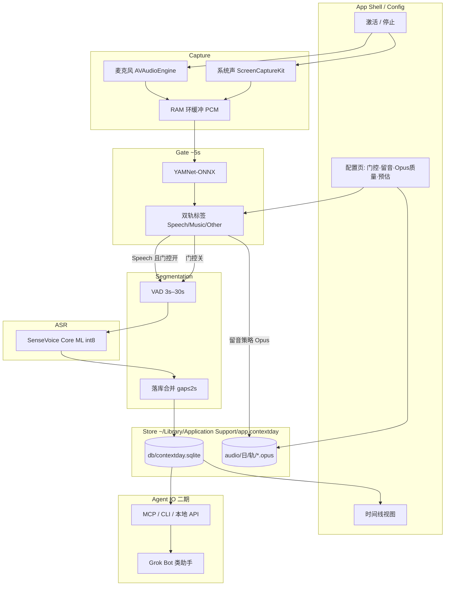

# ContextDay — 产品与技术 Spec

| 字段 | 值 |
|------|-----|
| 产品名 | ContextDay |
| Spec 文件 | `docs/01_spec.md` |
| Spec 版本 | **v0.2.0** |
| 状态 | schema_drafted / 未开工实现（数据目录与 Segment schema 已定稿） |
| 创建时间 | 2026-10-28 23:13 Asia/Shanghai |
| 最后更新 | 2026-10-28 23:24 Asia/Shanghai |
| 目标平台 | macOS（计划独立上架 Mac App Store） |
| 主工程路径（Mac） | `/Users/ruska/projects/ContextDay` |
| 云端工作区 | `/workspace/ContextDay`（经 GitHub 同步，独立于 notta） |
| GitHub | 私有仓 https://github.com/jqlong17/ContextDay |

---

## 1. 项目背景

### 1.1 要解决什么问题

对话助手（Grok Bot 及同类产品）缺的是**本机、连续、带时间戳的生活上下文**。用户一天里说话、开会、听播客的内容，若不在本地沉淀，助手只能依赖当前对话窗口，无法回答「今早我说了什么」「下午会议里谁定了什么」。

ContextDay 定位为：**本机 24h 语音上下文采集与转写层**，把可检索的时间线（文本 + 可选音频）交给上层助手 / MCP / CLI，而不是做成又一个云端录音日记。

### 1.2 产品边界

| 做 | 不做（MVP） |
|----|-------------|
| 激活后持续采集（麦 + 可选系统声） | 通话录音 / 隐蔽录音叙事 |
| 本机分类门控 + SenseVoice Core ML int8 转写 | 云端 ASR 主路径 |
| 时间线日志、邻近段合并、本地查询 | 重度社交 / 习惯打卡（避免与 DayTrace 等品类混淆） |
| 配置：门控、留音频策略与体积预估 | 与输入法壳强绑定（独立 App） |
| 向 Grok Bot 类产品暴露只读数据接口（后续 MCP/API） | 替助手做推理与总结（可由上层做） |

### 1.3 命名与竞品注意

- 已弃用：DayTrace、VoiceTrace、单名 Context（商店与品类冲突）。
- 选定：**ContextDay**（副标可写「本机全天语音上下文 / For agents」）。
- 上架前仍需自行核对商标与域名注册。

### 1.4 已有实测依据（选型）

本机 Apple Silicon Mac（2026-10-28）对比结论写入飞书：[本机 ASR 选型对比（MacBook 友好视角）](https://my.feishu.cn/docx/T6Sdd8q1ZoHLn6xV5JOcPWxhnyh)。

- **生活日志长期后台**：SenseVoice **Core ML int8**（本进程约 20–36 MB；~11.7s 试音识别约 2.6s）。
- **短时听写**（非本产品主路径）：SenseVoice ONNX 更快但内存高峰约 800–900+ MB。
- **音频门控**：YAMNet-ONNX，约 5s 窗；麦 / 系统**双轨独立标签**；Music 与 Speech 同高时 **Music 优先**。
- **采集策略**：环缓冲连续采 PCM；分类只打标，不挡采集。PCM 仅作内存环缓冲 / 调试暂存，**不是**用户可选手动「全日留音」质量档。

---

## 2. 产品设计

### 2.1 核心体验

1. 用户打开并**激活** ContextDay → 立即开始 24h 采集与（按策略）转写。
2. 默认开启**分类过滤**：约每 5s 对环缓冲已有音频打标；仅判定为 **Speech** 的片段送入 SenseVoice Core ML int8。
3. 时间线展示：**起止时间 + 文本**；落库时对邻近碎片自动合并，避免过于零散。
4. 配置页可关过滤、可选择是否保留音频及质量；未开过滤时**只能保留全部音频**（不可选「仅人声」）。

### 2.1.1 留音用途与默认策略（用户已确认）

保留音频的目的是：**事后抽查 / 回听某段作证据**（核对转写、调试门控），**不是** hi-fi 存档或音乐收藏。

| 规则 | 定稿 |
|------|------|
| 默认 | **`keep_audio` 关**；时间线以文本为主 |
| 开启后默认质量 | **Opus ~24 kbps**（体积小、人声可懂即可） |
| 可选更高档 | **Opus 64 kbps**（仍非无损） |
| 不提供 | 全日 **WAV / PCM / 16-bit** 等作为用户可见留音预设（体积过大；PCM 仅 RAM 环缓冲 / debug scratch，见 §2.4） |
| 磁盘格式 | 本机落盘默认 **`.opus`**（见 §3.4） |
| 日后可选 | 单段 **导出**为 m4a/mp4 等——属导出能力，**不是**默认 on-disk 格式 |

### 2.2 配置项（MVP）

| 配置 | 默认 | 说明 |
|------|------|------|
| 分类过滤（YAMNet） | **开** | 关则所有达 VAD 门槛的段都送 ASR；留音频不可选「仅人声」 |
| 保留音频 | **关** | 开则落盘 Opus，并展示**预估 1 天占用**；用途见 §2.1.1 |
| 音频范围 | 仅人声 / 全部 | 仅人声依赖分类过滤开启 |
| 质量档 | 开留音时默认 **Opus 24 kbps**；可选 **Opus 64 kbps** | 用户可见全日留音档**仅此二档**；**不提供** WAV/PCM/16-bit 预设（见 §2.4） |
| VAD | 静音结束约 1.5–2s；最短送识 **3s**；最长 **30s** | 与「展示合并 gap」分开配置 |
| 合并 gap | **2s**（可配 1–3s） | 同轨、相邻段间隔 ≤ gap 则合并（见 §3.3） |

### 2.3 分段与合并

- **门控层（~5s）**：决定「是否值得送 ASR / 是否按人声策略留音频」，**不**用 5s 硬切 ASR 句。
- **VAD 层**：决定送 ASR 的断点；最短 3s、最长 30s。
- **落库合并**：同轨（mic / system）、相邻 gap ≤ **2s**（可配 1–3s）合并为一条；保留合并后起止时间与原文拼接规则（细则见 §3.3）。

### 2.4 磁盘粗算（写进配置文案）

按 16 kHz mono 粗算（全天 24h，未计门控命中率折扣）。配置文案应强调留音是**证据回听**、默认关、开则优先 24 kbps：

| 档位 | 约占用 / 天 | 说明 |
|------|-------------|------|
| Opus 24 kbps | ~0.26 GB | 开启留音时的**默认**档 |
| Opus 64 kbps | ~0.7 GB | 可选 |

「仅人声」再按门控命中率打折；上线后用真实占比校准区间。配置页粗算文案只展示上表两档（不列 WAV/PCM 对比行）。

采集管线仍会在 **RAM 环缓冲**中使用短时 PCM（及可选 debug 落盘 scratch），与上表全日留音档无关。单段导出 m4a/mp4 为日后可选能力，不改变默认 `.opus` 落盘。

### 2.5 给 Grok Bot 类产品的价值

- 本地可查询的「今天到现在」语音时间线。
- 稳定 schema（时间、轨、文本、可选音频路径、分类标签）——与 §3.3 定稿一致；Phase 4 Agent IO 只读暴露同一模型。
- 后续：本机 MCP / HTTP / CLI，只读为主，供对话助手拉取上下文。

### 2.6 隐私与系统边界（产品文案必写）

- **默认本地-only**：不上云；路径与删除方式在关于页 / 设置中可发现（具体布局见 §3.4）。
- 滚动保留与「删除今日 / 清空全部」均操作 Application Support 下 DB 与 `audio/`（见 §3.4 可删路径）。
- 权限：麦克风；系统声需 ScreenCaptureKit 等授权。
- 锁屏 / 睡眠下采集能力边界需在验收中写明「支持到哪一档」。

---

## 3. 技术架构设计

### 3.1 模块划分

| 模块 | 职责 |
|------|------|
| `Capture` | 双轨采集（AVAudioEngine 麦 + ScreenCaptureKit 系统声）→ 环缓冲 |
| `Gate` | YAMNet-ONNX，~5s 窗，双轨独立标签，Music>Speech 偏置 |
| `VAD` | 断句；min 3s / max 30s；静音门槛与合并 gap 分离 |
| `ASR` | SenseVoice Core ML int8（主力）；失败时明确降级策略（不默认偷开 ONNX） |
| `Store` | 时间线条目、合并、可选 Opus 落盘；查询 API |
| `Config` | 门控 / 留音 / 质量 / 预估占用 UI（偏好见 §3.4） |
| `Export / Agent IO` | 后续 MCP/CLI/HTTP 只读接口；对外字段与 §3.3 一致（可二期） |
| `App Shell` | 激活态、菜单栏/窗口、权限引导、Mac App Store 打包 |

### 3.2 运行时原则

- **采集永不因分类延迟而停**；分类只标签已缓冲 PCM。
- **门控与 ASR 解耦**：Gate 决定 keep/transcribe；VAD 决定送模型切段。
- **本进程内存优先**：长期只留 Core ML；不把听写用 ONNX 绑进常驻路径。
- **轨语义**：过滤默认作用于「是否转写」；「全部保留音频」时非 Speech 仍可只存不转。

### 3.3 数据模型（定稿）

本机 SQLite（Swift 侧类型约定见下）为唯一权威；Phase 4 Agent IO **只读**暴露同一 schema，不做平行云端实体。

#### 3.3.1 时间与 ID 编码

| 约定 | 选择 | 说明 |
|------|------|------|
| 主键 / 外键 | **UUID**，存 TEXT（标准 8-4-4-4-12 小写） | Swift `UUID` ↔ SQLite TEXT |
| 绝对时间 | **Unix epoch 毫秒**（`INTEGER`，UTC） | `t0_ms` / `t1_ms` / `created_at_ms`；展示时按设备或 `tz_at_capture` 转本地 |
| 时区策略 | 落库存 **UTC ms** + 可选 **`tz_at_capture`**（IANA，如 `Asia/Shanghai`） | 避免「只有本地墙钟字符串」导致跨时区歧义；UI 默认按捕获时区显示起止 |
| 不采用 | ISO-8601 字符串作主键时间 | 查询区间与合并比较用整数 ms 更稳；Agent 导出时可派生 ISO-8601 |

#### 3.3.2 `gate_label` 枚举

与 YAMNet 门控用法对齐（Music 与 Speech 同高时 **Music 优先**，见 §1.4）：

| 值 | 含义 |
|----|------|
| `speech` | 判定为人声（默认可送 ASR；「仅人声」留音命中） |
| `music` | 判定为音乐（含 Music>Speech 偏置后的结果） |
| `other` | 其余（噪声、环境声、不确定等，MVP 不细拆） |

落库字段为 TEXT，仅允许上表三值。合并后的 `gate_label`：若源段不全相同，取**时间最长**的源段标签；并列则优先 `speech` > `music` > `other`（便于时间线检索人声）。

#### 3.3.3 `Segment`（时间线条目）

| 字段 | 类型（Swift / SQLite） | 必填 | 说明 |
|------|------------------------|------|------|
| `id` | `UUID` / TEXT | 是 | 段主键 |
| `track` | enum / TEXT | 是 | `mic` \| `system` |
| `t0_ms` | `Int64` / INTEGER | 是 | 段起始（UTC epoch ms） |
| `t1_ms` | `Int64` / INTEGER | 是 | 段结束（UTC epoch ms）；须 `t1_ms > t0_ms` |
| `tz_at_capture` | `String?` / TEXT | 否 | 捕获时 IANA 时区；缺省则展示用系统当前时区 |
| `text` | `String?` / TEXT | 否 | 转写文本；合并后为拼接结果 |
| `gate_label` | enum / TEXT | 否 | 见 §3.3.2；门控关且未打标时可空 |
| `audio_path` | `String?` / TEXT | 否 | **相对** Application Support 根的路径（见 §3.4）；无留音则空 |
| `source_segment_ids` | `[UUID]` / TEXT(JSON 数组) | 否 | 合并前碎片 id；未合并则为空数组或仅含自身（实现任选一种，查询层统一） |
| `created_at_ms` | `Int64` / INTEGER | 是 | 本行首次写入时间（UTC ms） |
| `merged_at_ms` | `Int64?` / INTEGER | 否 | 最近一次合并写入时间；未合并为空 |
| `merge_gap_ms` | `Int?` / INTEGER | 否 | 促成此次合并时使用的 gap 阈值（毫秒）；未合并为空 |
| `asr_model_id` | `String?` / TEXT | 否 | 如 `sensevoice-coreml-int8` |
| `asr_model_version` | `String?` / TEXT | 否 | 模型包版本或构建标识；廉价落库便于日后复盘 |

索引建议：`(track, t0_ms)`、`(t0_ms)`；全文检索二期再定。

#### 3.3.4 合并规则（定稿）

1. **同轨**：仅 `mic` 与 `mic`、或 `system` 与 `system` 可合并。
2. **间隙**：按 `t0_ms` 排序后，若 `next.t0_ms - prev.t1_ms ≤ merge_gap_ms`，则合并。`merge_gap_ms` 默认 **2000**，用户可配 **1000–3000**（与 §2.2 一致）。
3. **时间**：合并后 `t0_ms = min(...)`，`t1_ms = max(...)`。
4. **文本**：按时间序拼接；**段间不加空格/换行**（中文生活日志优先；英文粘连可接受，二期再加智能空格）。空 `text` 跳过。
5. **音频**：若多段均有 `audio_path`，MVP **保留最早一段的文件**并更新路径字段，或拼接为新 Opus 后删旧文件（实现二选一，须在删除策略中可回收孤儿文件）；仅一段有音频则继承该路径。
6. **`source_segment_ids`**：合并后为所有被并入碎片 id 的并集（若碎片本身已是合并结果，则展平为其 `source_segment_ids`，避免嵌套）。
7. **ASR 元数据**：`asr_model_id` / `asr_model_version` 取**最后一段**（时间上最晚）的非空值。

#### 3.3.5 伴生类型（MVP 最小）

**`AppConfig`（偏好快照，非云同步）** — 存 **UserDefaults**（见 §3.4），不进 Segment 表：

| 字段 | 类型 | 默认 | 说明 |
|------|------|------|------|
| `gate_enabled` | Bool | true | 分类过滤 |
| `keep_audio` | Bool | **false** | 是否落盘 Opus（证据回听；默认关） |
| `audio_scope` | enum | `speech_only` | `speech_only` \| `all`；`gate_enabled=false` 时强制 `all` |
| `audio_quality` | enum | **`opus_24`** | **仅** `opus_24` \| `opus_64`；无 wav/pcm 枚举值 |
| `merge_gap_ms` | Int | 2000 | 1000…3000 |
| `retention_days` | Int? | nil | 滚动保留天数；nil 表示暂不自动删（仍提供手动清空） |

**日 / 会话索引**：MVP **不**单独建 Day/Session 表。日历「某日」由本地时区下 `t0_ms` 落在该日的 Segment 查询派生。Phase 4 若需汇总，再加只读视图，不引入同步实体。

#### 3.3.6 Agent IO（Phase 4）约定

只读查询返回与上表字段同名的 JSON（时间用 epoch ms；可另附派生 ISO-8601 字段，但不替代权威 ms）。不另起一套 schema。

### 3.4 本机数据目录（定稿）

#### 3.4.1 根路径

计划 Bundle ID：`app.contextday`（Phase 0 Xcode 骨架锁定；若商店要求改 ID，只改根目录名，相对布局不变）。

```text
~/Library/Application Support/app.contextday/
├── db/
│   └── contextday.sqlite          # 时间线权威库（Segment 等）
├── audio/                         # 可选留音（keep_audio=true；默认 .opus，非 WAV/PCM）
│   └── YYYY-MM-DD/                # 本地日历日（捕获时区）
│       ├── mic/
│       │   └── <segment-uuid>.opus
│       └── system/
│           └── <segment-uuid>.opus
├── logs/                          # 可选诊断日志（滚动，可关）
│   └── contextday-YYYY-MM-DD.log
└── scratch/                       # 可选：短时 debug PCM / 崩溃残留；默认空；可进「清除缓存」
```

关于页 / 设置须展示：**Application Support 根路径**（可「在 Finder 中显示」），并说明默认不上云。日后若支持「导出片段为 m4a/mp4」，导出文件由用户另选位置，**不**写入上述 `audio/` 默认树。

#### 3.4.2 配置 vs 文件

| 数据 | 位置 | 说明 |
|------|------|------|
| 用户偏好（§3.3.5 `AppConfig`） | **UserDefaults**（`app.contextday` suite） | 不把开关写进 SQLite，避免与时间线备份混淆 |
| 时间线 / Segment | `db/contextday.sqlite` | 唯一权威 |
| 可选音频 | `audio/…/*.opus` | `Segment.audio_path` 存相对根路径，如 `audio/2026-10-28/mic/<uuid>.opus` |

#### 3.4.3 模型

- **优先 App Bundle 内置**（SenseVoice Core ML int8、YAMNet-ONNX 等）。
- **不要求** Application Support 下可写 `models/`；仅当日后支持「应用内下载/更新模型」时再增设可写目录，并在隐私说明中单列。

#### 3.4.4 滚动保留与可删路径（供 §2.6 / 设置文案引用）

| 操作 | 影响路径 |
|------|----------|
| 按 `retention_days` 滚动删除 | 删除早于阈值的 Segment 行 + 对应 `audio/YYYY-MM-DD/**`；空日目录可回收 |
| 删除某日 | 该日 Segment + `audio/YYYY-MM-DD/` |
| 清空全部上下文 | `db/contextday.sqlite`（重建空库）+ 清空 `audio/` |
| 清除缓存 / 日志 | `scratch/`、`logs/`（不影响时间线） |

磁盘将满时：优先停新留音并提示；转写可降级为只写文本（与 §3.5 一致）。

### 3.5 失败与降级

| 故障 | 行为 |
|------|------|
| Core ML 加载失败 | 提示；停转写或用户显式选降级（不静默上 ONNX） |
| YAMNet 失败 | 按配置：等同关闭过滤，或安全停写并提示 |
| 权限被拒 | 激活失败；引导系统设置 |
| 磁盘将满 | 停留音 / 滚动删除；转写可降级为只写文本 |

---

## 4. 技术架构拓扑图



---

## 5. 开发任务执行计划

### Phase 0 — Spec 与工程骨架（当前）

- [x] 产品命名 ContextDay；弃用冲突名
- [x] 本目录与 `docs/01_spec.md`
- [x] 数据目录与 schema 定稿（v0.2.0）
- [ ] Xcode / SPM 工程骨架、bundle id、权限 plist 草案

### Phase 1 — 采集 + 门控 MVP

- [ ] 双轨采集 + 环缓冲
- [ ] YAMNet 5s 双轨标签 + Music 优先
- [ ] 激活/停止与权限引导
- [ ] 菜单栏或主窗口「正在记录」态

### Phase 2 — ASR + 时间线

- [ ] SenseVoice Core ML int8 接入
- [ ] VAD 3–30s + 落库合并
- [ ] 时间线 UI（时间点 + 文本）
- [ ] 配置：门控开关、留音、Opus 质量、预估占用、仅人声约束

### Phase 3 — 稳固与商店向

- [ ] 锁屏/睡眠行为说明与测试
- [ ] 磁盘滚动与爆盘保护
- [ ] 隐私文案、本地路径、删除策略
- [ ] Notarize / App Store 素材与审核说明（持续录音敏感）

### Phase 4 — Agent 供数

- [ ] 只读 MCP 或本地 HTTP/CLI（字段同 §3.3）
- [ ] 与 Grok Bot 类产品对接样例
- [ ] 查询：按时间范围 / 关键词 / 轨

---

## 6. 测试用例（草案）

| ID | 场景 | 步骤要点 | 期望 |
|----|------|----------|------|
| T01 | 激活即采 | 授权后点激活 | 环缓冲有 PCM；UI 显示记录中 |
| T02 | 门控开 + 说话 | 对麦说话 ≥3s | 出现 Speech 标签；产生转写条目 |
| T03 | 门控开 + 纯音乐（系统轨） | 本机放歌 | Music 优先；默认不送 ASR |
| T04 | 门控关 | 关过滤后说话/放歌 | 达 VAD 的段均可送 ASR；留音不可选仅人声 |
| T05 | VAD 最短 | 极短爆破音 | 不足 3s 不落转写 |
| T06 | VAD 最长 | 连续说 >30s | 约 30s 切段 |
| T07 | 合并 | 两句间隔 ≤2s | 时间线一条；起止覆盖两端 |
| T08 | 碎段 | 间隔 >2s | 两条独立 |
| T09 | 留音预估 | 开留音并切换 Opus 24/64 | 默认关；开后默认 24；预估与 §2.4 同量级；无 WAV/PCM 全日档 |
| T10 | 仅人声留音 | 门控开 + 仅人声 | 非 Speech 不写音频文件 |
| T11 | 门控关 + 仅人声 | 试图勾选仅人声 | UI 禁用或强制「全部」 |
| T12 | Core ML 失败 | 移走模型 | 明确错误；不静默切 ONNX |
| T13 | 权限拒绝 | 拒麦 | 无法激活；可跳转设置 |
| T14 | 双轨同时 | 麦说话 + 系统放歌 | 两轨标签独立；策略各自生效 |
| T15 | 内存 | 记录 1h | 本进程内存保持 Core ML 档（量级几十 MB，允许波动） |

---

## 7. 验收标准（MVP）

1. 激活后可持续采集 ≥ 8h 不崩溃（开发机冒烟）；正式目标 24h。
2. 默认门控下：明显音乐段不产生转写；清晰人声段有文本与时间戳。
3. 时间线无「一秒一条」式碎到不可读；合并规则符合 gap≤2s。
4. 配置页三项齐全：门控、留音与 Opus 质量+日占用预估、仅人声/全部（约束正确）；留音默认关、开则默认 24 kbps；**无** WAV/PCM 全日留音选项。
5. 主力 ASR 为 SenseVoice Core ML int8；文档与关于页写明本机推理。
6. 隐私：默认不上云；Application Support 路径与删除方式可查（§3.4）。
7. 命名与商店素材使用 ContextDay，不与输入法产品混品牌。

---

## 8. 备忘录

- 门控 5s 与 VAD 切段是两级，不要合成一个旋钮。
- 留音默认关；开则默认 Opus 24、可选 64——为证据回听而非 hi-fi；禁止全日 WAV/PCM 预设；m4a/mp4 仅作日后导出。
- 审核叙事：用户显式激活的本机上下文工具，服务个人助手；非隐蔽监控。
- 与既有 YamnetGate / AsrCompare 实验代码可参考，但 ContextDay 工程独立，避免绑听写 ONNX 生命周期。
- 中文连续数字 Core ML 仍可能弱于 ONNX；生活日志可接受，需在已知问题中披露。
- Agent IO（MCP）可晚于 MVP 商店版本；schema 已于 v0.2.0 定稿，实现期避免无说明的破坏性改字段。
- 飞书 ASR 对比文已入个人总索引「个人 · 其他」。

---

## 9. Spec 版本信息与时间点

| 版本 | 时间（Asia/Shanghai） | 说明 |
|------|----------------------|------|
| v0.1.0 | 2026-10-28 23:13 | 初稿：背景、产品、架构、拓扑、计划、用例、验收、备忘 |
| v0.2.0 | 2026-10-28 23:22 | 定稿数据目录与 Segment schema；留音策略（默认关 / Opus 24·64 / 禁全日 WAV·PCM；用途=证据回听）；状态 → `schema_drafted` |

变更规则：改需求或架构时升次版本号（v0.x）；破坏性改 schema 在备忘与验收中标明，并更新「最后更新」。

---

## 10. 执行状态

| 项 | 状态 | 备注 |
|----|------|------|
| 命名 ContextDay | 已定 | 2026-10-28 |
| Spec v0.1.0 | 已完成 | 初稿 |
| Spec v0.2.0 | **已完成** | 数据目录 + Segment schema 定稿；留音默认关 / Opus 24·64；禁全日 WAV·PCM |
| 工程骨架 | 未开始 | Bundle ID 拟用 `app.contextday`（§3.4） |
| 采集 / 门控 | 未开始 | 可复用 YamnetGate 经验 |
| Core ML ASR | 未开始 | 可复用 AsrCompare 模型路径经验 |
| 时间线 / 配置 UI | 未开始 | |
| Agent IO | 未开始 | Phase 4；只读同 §3.3 |
| Mac App Store | 未开始 | |

**当前总状态：`schema_drafted`（文档定稿数据目录与 schema，无实现交付）**

---

## 11. 参考链接

- ASR 选型（含实测）：https://my.feishu.cn/docx/T6Sdd8q1ZoHLn6xV5JOcPWxhnyh
- 个人总索引：https://my.feishu.cn/wiki/Dk5hwo3NriVP5ukV5hicLgHDnHf
