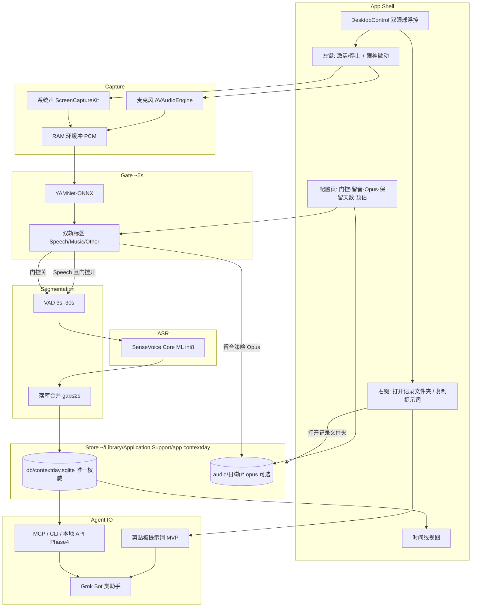

# ContextDay — 产品与技术 Spec

| 字段 | 值 |
|------|-----|
| 产品名 | ContextDay |
| Spec 文件 | `docs/01_spec.md` |
| Spec 版本 | **v0.3.2** |
| 状态 | Phase 0–4 MVP 路径落地：DesktopControl + 双轨 + ASR/Gate + HTTP/MCP stdio + 磁盘/睡眠/隐私文案 + XCTest |
| 创建时间 | 2026-10-28 23:13 Asia/Shanghai |
| 最后更新 | 2026-10-29 01:25 Asia/Shanghai |
| 目标平台 | macOS（计划独立上架 Mac App Store） |
| 主工程路径（Mac） | `/Users/ruska/projects/ContextDay` |
| 云端工作区 | `/workspace/ContextDay`（经 GitHub 同步，独立于 notta） |
| GitHub | 私有仓 https://github.com/jqlong17/ContextDay |

---

## 1. 项目背景

### 1.1 要解决什么问题

对话助手（Grok Bot 及同类产品）缺的是**本机、连续、带时间戳的生活上下文**。用户一天里说话、开会、听播客的内容，若不在本地沉淀，助手只能依赖当前对话窗口，无法回答「今早我说了什么」「下午会议里谁定了什么」。

ContextDay 定位为：**本机 24h 语音上下文采集与转写层**，把可检索的时间线（文本 + 可选音频）交给上层助手 / MCP / CLI，而不是做成又一个云端录音日记。

### 1.2 产品边界

| 做 | 不做（MVP） |
|----|-------------|
| 激活后持续采集（麦 + 可选系统声） | 通话录音 / 隐蔽录音叙事 |
| 本机分类门控 + SenseVoice Core ML int8 转写 | 云端 ASR 主路径 |
| 时间线日志、邻近段合并、本地查询 | 重度社交 / 习惯打卡（避免与 DayTrace 等品类混淆） |
| 配置：门控、留音频策略与体积预估 | 与输入法壳强绑定（独立 App） |
| 桌面拟物浮控 + 右键「打开记录文件夹 / 复制提示词」 | 另写每日转写 `.txt` 平行文件 |
| 向 Grok Bot 类产品暴露只读数据（MVP 剪贴板提示词；后续 MCP/API） | 替助手做推理与总结（可由上层做） |

### 1.3 命名与竞品注意

- 已弃用：DayTrace、VoiceTrace、单名 Context（商店与品类冲突）。
- 选定：**ContextDay**（副标可写「本机全天语音上下文 / For agents」）。
- 上架前仍需自行核对商标与域名注册。

### 1.4 已有实测依据（选型）

本机 Apple Silicon Mac（2026-10-28）对比结论写入飞书：[本机 ASR 选型对比（MacBook 友好视角）](https://my.feishu.cn/docx/T6Sdd8q1ZoHLn6xV5JOcPWxhnyh)。

- **生活日志长期后台**：SenseVoice **Core ML int8**（本进程约 20–36 MB；~11.7s 试音识别约 2.6s）。
- **短时听写**（非本产品主路径）：SenseVoice ONNX 更快但内存高峰约 800–900+ MB。
- **音频门控**：YAMNet-ONNX，约 5s 窗；麦 / 系统**双轨独立标签**；Music 与 Speech 同高时 **Music 优先**。
- **采集策略**：环缓冲连续采 PCM；分类只打标，不挡采集。PCM 仅作内存环缓冲 / 调试暂存，**不是**用户可选手动「全日留音」质量档。

---

## 2. 产品设计

### 2.1 核心体验

1. 用户打开并**激活** ContextDay → 立即开始 24h 采集与（按策略）转写。
2. 默认开启**分类过滤**：约每 5s 对环缓冲已有音频打标；仅判定为 **Speech** 的片段送入 SenseVoice Core ML int8。
3. 时间线展示：**起止时间 + 文本**；落库时对邻近碎片自动合并，避免过于零散。
4. 配置页可关过滤、可选择是否保留音频及质量；未开过滤时**只能保留全部音频**（不可选「仅人声」）。
5. 主交互为桌面拟物浮控（双眼 3D 球，见 §2.7）：左键切换激活/停止并播放眼神微动；右键打开记录目录或复制给 AI 的提示词。

### 2.1.1 留音用途与默认策略（用户已确认）

保留音频的目的是：**事后抽查 / 回听某段作证据**（核对转写、调试门控），**不是** hi-fi 存档或音乐收藏。

| 规则 | 定稿 |
|------|------|
| 默认 | **`keep_audio` 关**；时间线以文本为主 |
| 开启后默认质量 | **Opus ~24 kbps**（人声可懂、体积适中） |
| 更小档 | **Opus 12 kbps**（~0.13 GB/天；更省空间） |
| 可选更高档 | **Opus 64 kbps**（仍非无损） |
| 不提供 | 全日 **WAV / PCM / 16-bit** 等作为用户可见留音预设（PCM 仅 RAM 环缓冲 / debug scratch） |
| 磁盘格式 | 本机落盘默认 **`.opus`**（见 §3.4） |
| 日后可选 | 单段 **导出**为 m4a/mp4 等——属导出能力，**不是**默认 on-disk 格式 |

### 2.2 配置项（MVP）

| 配置 | 默认 | 说明 |
|------|------|------|
| 分类过滤（YAMNet） | **开** | 关则所有达 VAD 门槛的段都送 ASR；留音频不可选「仅人声」 |
| 保留音频 | **关** | 开则落盘 Opus，并展示**预估 1 天占用**；用途见 §2.1.1 |
| 音频范围 | 仅人声 / 全部 | 仅人声依赖分类过滤开启 |
| 质量档 | 开留音时默认 **Opus 24 kbps**；另可选 **12** / **64 kbps** | 用户可见全日留音档**仅此三档**；**不提供** WAV/PCM/16-bit 预设（见 §2.4） |
| VAD | 静音结束约 1.5–2s；最短送识 **3s**；最长 **30s** | 与「展示合并 gap」分开配置 |
| 合并 gap | **2s**（可配 1–3s） | 同轨、相邻段间隔 ≤ gap 则合并（见 §3.3） |
| 滚动保留天数 | **建议默认 30** | 可改；**nil = 不自动删**（仍提供手动清空）；设置里可发现 |

### 2.3 分段与合并

- **门控层（~5s）**：决定「是否值得送 ASR / 是否按人声策略留音频」，**不**用 5s 硬切 ASR 句。
- **VAD 层**：决定送 ASR 的断点；最短 3s、最长 30s。
- **落库合并**：同轨（mic / system）、相邻 gap ≤ **2s**（可配 1–3s）合并为一条；保留合并后起止时间与原文拼接规则（细则见 §3.3）。

### 2.4 磁盘粗算（写进配置文案）

按 16 kHz mono 粗算（全天 24h，未计门控命中率折扣）。配置文案应强调留音是**证据回听**、默认关、开则默认 24 kbps：

| 档位 | 约占用 / 天 | 说明 |
|------|-------------|------|
| Opus 12 kbps | ~0.13 GB | 更小档（可选） |
| Opus 24 kbps | ~0.26 GB | 开启留音时的**默认**档 |
| Opus 64 kbps | ~0.7 GB | 更高档（可选） |

「仅人声」再按门控命中率打折；上线后用真实占比校准区间。配置页粗算文案只展示上表三档（不列 WAV/PCM 对比行）。

采集管线仍会在 **RAM 环缓冲**中使用短时 PCM（及可选 debug 落盘 scratch），与上表全日留音档无关。单段导出 m4a/mp4 为日后可选能力，不改变默认 `.opus` 落盘。

### 2.5 给 Grok Bot 类产品的价值

- 本地可查询的「今天到现在」语音时间线（权威在 SQLite，**不**另写每日转写 txt）。
- 稳定 schema（时间、轨、文本、可选音频路径、分类标签）——与 §3.3 定稿一致；Phase 4 Agent IO 只读暴露同一模型。
- **MVP 轻量供数**：右键「复制提示词」把背景说明 + Application Support / DB 绝对路径放进剪贴板，供 Grok 等助手只读访问（见 §2.8）。
- 后续：本机 MCP / HTTP / CLI，只读为主，供对话助手拉取上下文。

### 2.6 隐私与系统边界（产品文案必写）

- **默认本地-only**：不上云；路径与删除方式在关于页 / 设置中可发现（具体布局见 §3.4）。
- 滚动保留与「删除今日 / 清空全部」均操作 Application Support 下 DB 与 `audio/`（见 §3.4 可删路径）。
- 权限：麦克风；系统声需 ScreenCaptureKit 等授权。
- 锁屏 / 睡眠边界（定稿）：**睡眠时停止采集，唤醒不自动续录**（须用户再次开始录音）。锁屏下麦轨在已授权且进程仍运行时可能继续；系统声依赖 ScreenCaptureKit，锁屏后可能中断。正式 24h 目标需保持 Mac 唤醒 / 接电源策略。详见 App「关于与隐私…」与 `docs/store-review-notes.md`。

### 2.7 桌面控制（双眼 3D 拟物球）

产品主壳是桌面上的**双眼 3D 拟物小球**（台球质感、双胶囊竖眼；与 Grok Bot 结合叙事）。用户已确认定稿艺术图与点击眼神微动 clip。

设计参考（**仅参考 / 备份，不作为唯一运行时路径**）：`design/icon-orb-eyes-v1.png`、`design/icon-orb-eye-click-2s.mp4`、`design/ref-icon-billiard.png`。早期 Bauhaus 圆角方钮探索（`design/btn-b-*`、`Resources/DesktopButton/`）已**废弃**，见下表。

#### 2.7.1 视觉资源

| 资源 | 路径 / Asset 名 | 说明 |
|------|-----------------|------|
| Idle（产品 + 桌面） | `Resources/DesktopOrb/idle.png`；Asset Catalog：`DesktopOrbIdle` | **透明背景** 1024 PNG；双眼球默认态 |
| 点击眼神微动 | `Resources/DesktopOrb/eye-click-2s.mp4`；可拷入 Bundle 或 Asset | 约 **2s**；首帧=尾帧；仅眼神微动，球身几乎不动 |
| App Icon 源图 | `Resources/AppIcon/icon-1024.png` → `AppIcon.appiconset` | **与 idle 同款艺术图**；导出各尺寸 |
| 废弃（已删） | `Resources/DesktopButton/` | 旧 Bauhaus 双态；已被 DesktopOrb 取代；仓库中已移除 |

MVP 视觉约定：

- **录制中与 idle 可用同一颗球**（同一 `idle.png`）；录制态额外视觉提示（如微光环 / 角标）= **二期可选**，不挡 MVP。
- 左键点击时播放 `eye-click-2s.mp4`，播完后回到 idle 静帧（首尾同帧，可无缝循环或 settle）。
- **不做**旧版「raised/pressed 双 PNG + 2px 下移」按压叙事；反馈以**眼神微动**为主。

#### 2.7.2 窗口层级（硬性要求）

桌面浮控窗口的 **window level 处于或低于普通窗口**，使 Safari / Chrome 等其它 App **可以遮盖**本浮控。禁止 `floating` / always-on-top / status-level 置顶。层级语义：**桌面最底层控件**，不是 HUD。

#### 2.7.3 交互（MVP）

| 操作 | 行为 |
|------|------|
| 左键 / 主键点击 | **切换**激活 ↔ 停止采集；同时播放 `eye-click-2s` 眼神微动，结束后 settle 到 idle 静帧。MVP：**录制中与 idle 视觉可相同**（二期再加录制态线索） |
| 右键 | 弹出上下文菜单（见下） |

右键菜单（MVP）：

| 菜单项 | 行为 |
|--------|------|
| **开始录音** | 与左键「激活」同一路径：开始采集；未在录制时可点；播放眼神微动 |
| **暂停录音** | 与左键「停止」同一路径：停止采集；正在录制时可点；播放眼神微动 |
| **打开记录文件夹** | `NSWorkspace` 在 Finder 中打开**当前记录根**（默认 `~/Downloads/ContextDay/`，或用户「修改保存文件夹」所选；可见 `db/` 与 `audio/`；**不**打开虚构的「每日 txt 目录」） |
| **复制提示词** | 将 §2.8 定稿模板（运行时填入**当前记录根**绝对路径）写入系统剪贴板（general pasteboard） |
| **修改保存文件夹…** | `NSOpenPanel` 选择目录，写入 UserDefaults `recordsRootPath`；Store 按新根重开 DB |
| **调整大小** | 子菜单：48 / 64 / 80 / 96 / 128 pt；默认 **64**；持久化 UserDefaults `orbSizePt` |
| **设置…** | 打开配置窗：门控、留音/Opus、仅人声约束、保留天数、系统声 |
| **时间线…** | 打开只读时间线（读自 SQLite） |
| **关于与隐私…** | 本地路径、删除/保留策略、锁屏/睡眠边界、Agent IO 说明 |

### 2.8 剪贴板提示词（Agent IO 轻量路径）

> **定稿建议已采纳进 Spec**：MVP 用「复制提示词」先于完整 MCP（Phase 4 仍计划）；避免「给 AI 用」只停留在远期接口。

实现须把下列中文模板复制到剪贴板（花括号处由运行时替换为**本机绝对路径**；字段摘要可随 Spec 小改但不得删掉「只读 / 勿删用户数据 / 转写在 SQLite」要点）：

```text
你正在协助使用 ContextDay（本机 24h 语音上下文采集与转写层）。请只读访问下列本机数据，不要删除、移动或清空用户文件。

产品一句话：ContextDay 在 macOS 本机持续采集麦克风/可选系统声，经门控与 ASR 后把时间线写入 SQLite；转写权威在数据库，不另写每日 txt。

数据根目录（Application Support）：
{APPLICATION_SUPPORT_ROOT}

权威数据库：
{APPLICATION_SUPPORT_ROOT}/db/contextday.sqlite

可选留音（仅当用户开启 keep_audio；Opus）：
{APPLICATION_SUPPORT_ROOT}/audio/YYYY-MM-DD/{mic|system}/<segment-uuid>.opus

Segment 字段摘要（详见产品 Spec §3.3）：
id(UUID), track(mic|system), t0_ms/t1_ms(UTC epoch ms), tz_at_capture(IANA?),
text(转写), gate_label(speech|music|other?), audio_path(相对根路径?),
source_segment_ids, created_at_ms, merged_at_ms?, merge_gap_ms?,
asr_model_id?, asr_model_version?

建议做法：用只读方式打开 SQLite（如 `sqlite3` 查询），按 t0_ms 时间范围检索 text；若需核对语音，再按 audio_path 拼绝对路径播放。不要假设存在每日转写 .txt。不要修改表结构或删除行，除非用户在对话中明确要求并再次确认。
```

### 2.9 Agent IO 语义工具（首波定稿）

> **v0.3.2**：在 §2.8 剪贴板轻量路径之上，定稿**只读语义工具**表面，供本机 MCP / 本地服务 / 测试直接调用。字段与 §3.3 Segment 对齐；**不改 schema**。

原则：

- **只读**：不得删除、移动、清空用户数据；不得改表结构。
- **权威在 SQLite**：返回转写文本来自 `Segment.text`，不假设每日 `.txt`。
- **JSON 友好**：对外 DTO 使用 snake_case 字段名（见下）。

#### 2.9.1 首波工具（必须实现 / stub 可查）

| 工具 | 参数 | 说明 |
|------|------|------|
| `search_segments` | `t0_ms?`, `t1_ms?`, `query?`, `track?`, `page?`, `max_chars?` | 按时间窗 + 可选关键词 / 轨检索；`page` 从 0；`max_chars` 可截断单段 `text` |
| `get_recent` | `hours?` **或** `limit?`, `track?` | 最近时段或最近 N 条；二者可只传其一，都缺则默认 `hours=24` |
| `get_window` | `t0_ms`, `t1_ms`, `track?` | 闭开或闭闭由实现注明；返回窗内全部段（可再受内部安全上限） |
| `list_activity` | `t0_ms?`, `t1_ms?` | 粗粒度活动摘要（按日/小时桶计数等）；无数据时返回空列表 |

每段对外字段（JSON）：

| 字段 | 类型 | 说明 |
|------|------|------|
| `segment_id` | string (UUID) | 对应 Segment.`id` |
| `t0_ms` / `t1_ms` | int64 | UTC epoch ms |
| `track` | `"mic"` \| `"system"` | |
| `gate_label` | `"speech"` \| `"music"` \| `"other"` \| null | 可空 |
| `text` | string \| null | 转写；可被 `max_chars` 截断 |

空库 / 无命中：**返回空数组**，不得崩溃。

#### 2.9.2 非首波（明确不可用）

| 工具 | 状态 |
|------|------|
| `summarize_window` | **unavailable** — 不做本机摘要；留给上层助手 |
| `export_audio` | **unavailable** — 首波不导出音频字节 |

实现须对上述名称返回明确的「未实现 / 非首波」错误，避免静默空成功。

#### 2.9.3 承载

- 源码：`Features/AgentIO/`（服务 API + JSON DTO；可选本地 MCP skeleton）。
- MVP 仍保留 §2.8 剪贴板；完整 MCP 传输层可 Phase 4 再挂同一套工具名。


---

## 3. 技术架构设计

### 3.1 模块划分与源码树

| 模块 | 职责 |
|------|------|
| `App` | `@main`、生命周期；可选 AppDelegate / 菜单栏入口 |
| `Features/DesktopControl` | 浮控 `NSWindow`（层级见 §2.7.2）、`DesktopOrb` idle + eye-click 播放、右键菜单、剪贴板写入 |
| `Features/Capture` | 双轨采集（AVAudioEngine 麦 + ScreenCaptureKit 系统声）→ 环缓冲 |
| `Features/Gate` | YAMNet-ONNX，~5s 窗，双轨独立标签，Music>Speech 偏置 |
| `Features/VAD` | 断句；min 3s / max 30s；静音门槛与合并 gap 分离 |
| `Features/ASR` | SenseVoice Core ML int8（主力）；失败时明确降级策略（不默认偷开 ONNX） |
| `Features/Store` | SQLite 时间线、合并、可选 Opus 落盘；**唯一转写权威**；查询 API；**不**写平行 transcript txt |
| `Features/Config` | 门控 / 留音 / 质量 / 预估占用 / 滚动保留 UI（偏好见 §3.4） |
| `Features/AgentIO` | §2.9 只读语义工具；HTTP + MCP stdio 传输；MVP 另见 §2.8 剪贴板 |
| `Resources` | `DesktopOrb/`、`AppIcon/`（`AppIcon.appiconset`）等打包资源 |

源码树草图（实现期可微调文件名，**模块边界与资源路径保持一致**）：

```text
ContextDay/
  App/                         # @main；AppDelegate / Menu 若有
  Features/
    DesktopControl/            # window、DesktopOrb idle + eye-click、context menu、pasteboard
    Capture/
    Gate/
    VAD/
    ASR/
    Store/                     # SQLite only；无每日 txt writer
    Config/
    AgentIO/                   # §2.9 语义工具 + 协议类型；Phase 4 可挂 MCP
  Resources/
    DesktopOrb/
      idle.png                 # 透明 1024；产品 + 桌面
      eye-click-2s.mp4         # ~2s 眼神微动；首帧=尾帧
    AppIcon/
      icon-1024.png            # 与 idle 同款 → Assets.xcassets/AppIcon.appiconset
  docs/
    01_spec.md
    agent-io-mcp.md            # HTTP / MCP / Grok 样例
    store-review-notes.md      # 商店审核说明草稿
  Tests/                       # ContextDayTests (XCTest)
  Scripts/
    fetch-models.sh
    mac-verify.sh
    contextday-cli.sh
```

**资源引用**：Bundle `DesktopOrb/idle.png`（运行时 chroma-key）+ `eye-click-2s.mp4`/`.mov`；`DesktopControl` 拥有窗口 level、点击播片与菜单；`Store` 拥有 SQLite 与可选 `audio/`；二者之间无平行转写文件通道。App Icon 源图与 `DesktopOrb/idle.png` 同艺术。`DesktopButton/` 已删除，勿再引用。

### 3.2 运行时原则

- **采集永不因分类延迟而停**；分类只标签已缓冲 PCM。
- **门控与 ASR 解耦**：Gate 决定 keep/transcribe；VAD 决定送模型切段。
- **本进程内存优先**：长期只留 Core ML；不把听写用 ONNX 绑进常驻路径。
- **轨语义**：过滤默认作用于「是否转写」；「全部保留音频」时非 Speech 仍可只存不转。
- **转写权威唯一**：Segment.`text` 只写 SQLite；禁止生成「每日转写 txt」作为产品路径。

### 3.3 数据模型（定稿）

本机 SQLite（Swift 侧类型约定见下）为**唯一转写与时间线权威**；Phase 4 Agent IO **只读**暴露同一 schema，不做平行云端实体，也**不**做每日 txt 投影。

#### 3.3.1 时间与 ID 编码

| 约定 | 选择 | 说明 |
|------|------|------|
| 主键 / 外键 | **UUID**，存 TEXT（标准 8-4-4-4-12 小写） | Swift `UUID` ↔ SQLite TEXT |
| 绝对时间 | **Unix epoch 毫秒**（`INTEGER`，UTC） | `t0_ms` / `t1_ms` / `created_at_ms`；展示时按设备或 `tz_at_capture` 转本地 |
| 时区策略 | 落库存 **UTC ms** + 可选 **`tz_at_capture`**（IANA，如 `Asia/Shanghai`） | 避免「只有本地墙钟字符串」导致跨时区歧义；UI 默认按捕获时区显示起止 |
| 不采用 | ISO-8601 字符串作主键时间 | 查询区间与合并比较用整数 ms 更稳；Agent 导出时可派生 ISO-8601 |

#### 3.3.2 `gate_label` 枚举

与 YAMNet 门控用法对齐（Music 与 Speech 同高时 **Music 优先**，见 §1.4）：

| 值 | 含义 |
|----|------|
| `speech` | 判定为人声（默认可送 ASR；「仅人声」留音命中） |
| `music` | 判定为音乐（含 Music>Speech 偏置后的结果） |
| `other` | 其余（噪声、环境声、不确定等，MVP 不细拆） |

落库字段为 TEXT，仅允许上表三值。合并后的 `gate_label`：若源段不全相同，取**时间最长**的源段标签；并列则优先 `speech` > `music` > `other`（便于时间线检索人声）。

#### 3.3.3 `Segment`（时间线条目）

| 字段 | 类型（Swift / SQLite） | 必填 | 说明 |
|------|------------------------|------|------|
| `id` | `UUID` / TEXT | 是 | 段主键 |
| `track` | enum / TEXT | 是 | `mic` \| `system` |
| `t0_ms` | `Int64` / INTEGER | 是 | 段起始（UTC epoch ms） |
| `t1_ms` | `Int64` / INTEGER | 是 | 段结束（UTC epoch ms）；须 `t1_ms > t0_ms` |
| `tz_at_capture` | `String?` / TEXT | 否 | 捕获时 IANA 时区；缺省则展示用系统当前时区 |
| `text` | `String?` / TEXT | 否 | 转写文本；合并后为拼接结果（**仅存库，不写 txt**） |
| `gate_label` | enum / TEXT | 否 | 见 §3.3.2；门控关且未打标时可空 |
| `audio_path` | `String?` / TEXT | 否 | **相对** Application Support 根的路径（见 §3.4）；无留音则空 |
| `source_segment_ids` | `[UUID]` / TEXT(JSON 数组) | 否 | 合并前碎片 id；未合并则为空数组或仅含自身（实现任选一种，查询层统一） |
| `created_at_ms` | `Int64` / INTEGER | 是 | 本行首次写入时间（UTC ms） |
| `merged_at_ms` | `Int64?` / INTEGER | 否 | 最近一次合并写入时间；未合并为空 |
| `merge_gap_ms` | `Int?` / INTEGER | 否 | 促成此次合并时使用的 gap 阈值（毫秒）；未合并为空 |
| `asr_model_id` | `String?` / TEXT | 否 | 如 `sensevoice-coreml-int8` |
| `asr_model_version` | `String?` / TEXT | 否 | 模型包版本或构建标识；廉价落库便于日后复盘 |

索引建议：`(track, t0_ms)`、`(t0_ms)`；全文检索二期再定。

#### 3.3.4 合并规则（定稿）

1. **同轨**：仅 `mic` 与 `mic`、或 `system` 与 `system` 可合并。
2. **间隙**：按 `t0_ms` 排序后，若 `next.t0_ms - prev.t1_ms ≤ merge_gap_ms`，则合并。`merge_gap_ms` 默认 **2000**，用户可配 **1000–3000**（与 §2.2 一致）。
3. **时间**：合并后 `t0_ms = min(...)`，`t1_ms = max(...)`。
4. **文本**：按时间序拼接；**段间不加空格/换行**（中文生活日志优先；英文粘连可接受，二期再加智能空格）。空 `text` 跳过。
5. **音频（MVP 定稿）**：若多段均有 `audio_path`，**保留最早一段（按 t0_ms）的文件**，更新合并行的 `audio_path`；其余文件标为孤儿并**调度删除**。拼接成新 Opus = **后期**能力，不进 MVP。仅一段有音频则继承该路径。
6. **`source_segment_ids`**：合并后为所有被并入碎片 id 的并集（若碎片本身已是合并结果，则展平为其 `source_segment_ids`，避免嵌套）。
7. **ASR 元数据**：`asr_model_id` / `asr_model_version` 取**最后一段**（时间上最晚）的非空值。

#### 3.3.5 伴生类型（MVP 最小）

**`AppConfig`（偏好快照，非云同步）** — 存 **UserDefaults**（见 §3.4），不进 Segment 表：

| 字段 | 类型 | 默认 | 说明 |
|------|------|------|------|
| `gate_enabled` | Bool | true | 分类过滤 |
| `keep_audio` | Bool | **false** | 是否落盘 Opus（证据回听；默认关） |
| `audio_scope` | enum | `speech_only` | `speech_only` \| `all`；`gate_enabled=false` 时强制 `all` |
| `audio_quality` | enum | **`opus_24`** | **仅** `opus_12` \| `opus_24` \| `opus_64`；无 wav/pcm 枚举值 |
| `merge_gap_ms` | Int | 2000 | 1000…3000 |
| `retention_days` | Int? | **建议默认 30** | 滚动保留天数；**nil = 不自动删**（仍提供手动清空）；设置里可改 / 可发现 |

**日 / 会话索引**：MVP **不**单独建 Day/Session 表。日历「某日」由本地时区下 `t0_ms` 落在该日的 Segment 查询派生。Phase 4 若需汇总，再加只读视图，不引入同步实体。

#### 3.3.6 Agent IO（Phase 4）约定

只读查询返回与上表字段同名的 JSON（时间用 epoch ms；可另附派生 ISO-8601 字段，但不替代权威 ms）。不另起一套 schema。MVP 阶段用 §2.8 剪贴板提示词作为轻量供数；Phase 4 再接 MCP/HTTP/CLI。

### 3.4 本机数据目录（定稿）

#### 3.4.1 根路径

计划 Bundle ID：`app.contextday`（Phase 0 Xcode 骨架锁定；若商店要求改 ID，只改根目录名，相对布局不变）。

```text
~/Library/Application Support/app.contextday/
├── db/
│   └── contextday.sqlite          # 时间线与转写唯一权威（Segment 等）
├── audio/                         # 仅可选留音（keep_audio=true；默认 .opus）
│   └── YYYY-MM-DD/                # 见 §3.4.5 日界规则
│       ├── mic/
│       │   └── <segment-uuid>.opus
│       └── system/
│           └── <segment-uuid>.opus
├── logs/                          # 可选诊断日志（滚动，可关）
│   └── contextday-YYYY-MM-DD.log
└── scratch/                       # 可选：短时 debug PCM / 崩溃残留；默认空；可进「清除缓存」
```

**明确不做**：在日目录或别处写入转写 `.txt` / 「每日记录文本」。转写只在 `db/contextday.sqlite` 的 `Segment.text`。

关于页 / 设置须展示：**Application Support 根路径**（可「在 Finder 中显示」；与右键「打开记录文件夹」同一路径），并说明默认不上云。日后若支持「导出片段为 m4a/mp4」，导出文件由用户另选位置，**不**写入上述 `audio/` 默认树。

#### 3.4.2 配置 vs 文件

| 数据 | 位置 | 说明 |
|------|------|------|
| 用户偏好（§3.3.5 `AppConfig`） | **UserDefaults**（`app.contextday` suite） | 不把开关写进 SQLite，避免与时间线备份混淆 |
| 时间线 / 转写 Segment | `db/contextday.sqlite` | **唯一权威**；无平行 txt |
| 可选音频 | `audio/…/*.opus` | `Segment.audio_path` 存相对根路径，如 `audio/2026-10-28/mic/<uuid>.opus` |

#### 3.4.3 模型

- **优先 App Bundle 内置**（SenseVoice Core ML int8、YAMNet-ONNX 等）。
- **不要求** Application Support 下可写 `models/`；仅当日后支持「应用内下载/更新模型」时再增设可写目录，并在隐私说明中单列。

#### 3.4.4 滚动保留与可删路径（供 §2.6 / 设置文案引用）

| 操作 | 影响路径 |
|------|----------|
| 按 `retention_days` 滚动删除 | 删除早于阈值的 Segment 行 + 对应 `audio/YYYY-MM-DD/**`；空日目录可回收 |
| 删除某日 | 该日 Segment + `audio/YYYY-MM-DD/`（若存在） |
| 清空全部上下文 | `db/contextday.sqlite`（重建空库）+ 清空 `audio/` |
| 清除缓存 / 日志 | `scratch/`、`logs/`（不影响时间线） |

磁盘将满时：优先停新留音并提示；转写可降级为只写文本（与 §3.5 一致）。

#### 3.4.5 `audio/YYYY-MM-DD/` 日界规则

- 日目录名用**本地日历日**：优先 `tz_at_capture`（IANA）；缺省则用**系统当前时区**。
- 一段若跨午夜：仍为**一行** Segment；音频文件落在 **`t0_ms` 所在本地日历日**目录下（不按 t1 切文件）。

### 3.5 失败与降级

| 故障 | 行为 |
|------|------|
| Core ML 加载失败 | 提示；停转写或用户显式选降级（不静默上 ONNX） |
| YAMNet 失败 | 按配置：等同关闭过滤，或安全停写并提示 |
| 权限被拒 | 激活失败；引导系统设置 |
| 磁盘将满 | 停留音 / 滚动删除；转写可降级为只写文本（仍写 SQLite，不改写 txt） |

---

## 4. 技术架构拓扑图



---

## 5. 开发任务执行计划

### Phase 0 — Spec 与工程骨架（当前）

- [x] 产品命名 ContextDay；弃用冲突名
- [x] 本目录与 `docs/01_spec.md`
- [x] 数据目录与 schema 定稿（v0.2.0）
- [x] 桌面浮控 / 右键与剪贴板提示词写入 Spec（v0.3.0）
- [x] 双眼 3D 球定稿：`DesktopOrb/idle.png`、`eye-click-2s.mp4`、`AppIcon/icon-1024.png`；Spec → v0.3.1
- [x] 打包 `DesktopOrb/`（idle + eye-click）；idle 走 Bundle PNG + 运行时 chroma-key（不依赖 Assets `DesktopOrbIdle`）
- [x] App Icon：`AppIcon.appiconset` 自 `icon-1024.png` 导出各尺寸（炭灰不透明底）
- [x] Xcode / SPM 工程骨架、bundle id `app.contextday`、权限 plist / entitlements
- [x] Spec v0.3.2 §2.9 Agent IO 语义工具首波定稿
- [x] 废弃 `DesktopButton/`：仓库中已无该目录；源码树说明保留「勿再引用」

### Phase 1 — 采集 + 门控 + 桌面壳 MVP

- [x] 双轨采集 + 环缓冲（mic AVAudioEngine + 可选 ScreenCaptureKit 系统声）
- [x] YAMNet 5s 双轨标签 + Music 优先（`decideLabel`；ONNX 需 `Scripts/fetch-models.sh`）
- [x] DesktopControl：`.normal` 窗口、orb idle + 左键播 eye-click（末帧 settle）、激活/停止、麦权限引导
- [x] 右键：打开记录根；复制 §2.8 提示词；开始/暂停录音；修改保存文件夹；调整大小；设置/时间线/关于与隐私
- [x] MVP 录制态可与 idle 同视觉；录制态额外线索（光环等）= 二期

### Phase 2 — ASR + 时间线

- [x] SenseVoice Core ML int8 接入（失败明确报错；禁止静默 ONNX ASR）
- [x] VAD 3–30s + 落库合并（多段音频保留最早文件；XCTest 覆盖）
- [x] 时间线 UI（时间点 + 文本；读自 SQLite）
- [x] 配置：门控开关、留音、Opus 质量、预估占用、仅人声/全部约束、`retention_days`（默认 30）、系统声开关

### Phase 3 — 稳固与商店向

- [x] 锁屏/睡眠行为说明：睡眠停采且唤醒不自动续录；关于页 + §2.6 定稿；`willSleep` 观察者
- [x] 磁盘滚动（`RetentionPurger` + `retention_days`）与爆盘保护（`DiskSpaceGuard` 停留音）
- [x] 隐私文案、本地路径、删除策略（「关于与隐私…」+ Info.plist usage）
- [x] App Store / 公证审核说明草稿（`docs/store-review-notes.md`）；**正式公证仍待提交时执行**

### Phase 4 — Agent 供数（完整接口）

- [x] 本地 HTTP JSON（`127.0.0.1:8787`）挂 §2.9 四工具；剪贴板 MVP 仍可用
- [x] MCP stdio 传输（`ContextDay --mcp`，无第三方 SDK）+ `Scripts/contextday-cli.sh`
- [x] 查询：按时间范围 / 关键词 / 轨（`search_segments` / `get_window` / `get_recent` / `list_activity`）
- [x] XCTest：`ContextDayTests`（merge / Agent IO / YamNet bias / SenseVoice load-skip / retention）
- [x] 与 Grok Bot 类产品对接样例（`docs/agent-io-mcp.md` + §2.8 提示词）

---

## 6. 测试用例（草案）

| ID | 场景 | 步骤要点 | 期望 |
|----|------|----------|------|
| T01 | 激活即采 | 授权后左键浮控 | 环缓冲有 PCM；播放 eye-click 后 settle；UI 显示记录中（MVP 球可仍为 idle） |
| T02 | 门控开 + 说话 | 对麦说话 ≥3s | 出现 Speech 标签；SQLite 产生转写条目 |
| T03 | 门控开 + 纯音乐（系统轨） | 本机放歌 | Music 优先；默认不送 ASR |
| T04 | 门控关 | 关过滤后说话/放歌 | 达 VAD 的段均可送 ASR；留音不可选仅人声 |
| T05 | VAD 最短 | 极短爆破音 | 不足 3s 不落转写 |
| T06 | VAD 最长 | 连续说 >30s | 约 30s 切段 |
| T07 | 合并 | 两句间隔 ≤2s | 时间线一条；起止覆盖两端 |
| T08 | 碎段 | 间隔 >2s | 两条独立 |
| T09 | 留音预估 | 开留音并切换 Opus 12/24/64 | 默认关；开后默认 24；预估与 §2.4 同量级；无 WAV/PCM 全日档 |
| T10 | 仅人声留音 | 门控开 + 仅人声 | 非 Speech 不写音频文件 |
| T11 | 门控关 + 仅人声 | 试图勾选仅人声 | UI 禁用或强制「全部」 |
| T12 | Core ML 失败 | 移走模型 | 明确错误；不静默切 ONNX |
| T13 | 权限拒绝 | 拒麦 | 无法激活；可跳转设置 |
| T14 | 双轨同时 | 麦说话 + 系统放歌 | 两轨标签独立；策略各自生效 |
| T15 | 内存 | 记录 1h | 本进程内存保持 Core ML 档（量级几十 MB，允许波动） |
| T16 | 浮控层级 | 浮控（orb）可见时打开浏览器全屏/前置窗口 | 浏览器**可遮盖**浮控；非 always-on-top |
| T17 | 打开记录文件夹 | 右键 → 打开记录文件夹 | Finder 打开 Application Support 根；可见 `db/`（及可选 `audio/`）；**无**要求存在每日 txt |
| T18 | 复制提示词 | 右键 → 复制提示词 → 粘贴到文本编辑器 | 含产品一句话、Application Support / sqlite 绝对路径、Segment 摘要、「转写在 SQLite 非 txt」、只读勿删提示 |
| T19 | 无 txt 落盘 | 激活并产生至少一条转写后扫盘 | Application Support 下**无**转写用途的 `.txt`；文本仅在 sqlite |
| T20 | 合并留最早音 | keep_audio 开；两段均有 opus 且间隔 ≤gap | 合并后 `audio_path` 指向最早段文件；孤儿文件被调度删除 |
| T21 | 眼神微动 | 左键点击浮控 | 播放约 2s eye-click；首尾同帧 settle；球身无明显缩放/位移 |

---

## 7. 验收标准（MVP）

1. 激活后可持续采集 ≥ 8h 不崩溃（开发机冒烟）；正式目标 24h。
2. 默认门控下：明显音乐段不产生转写；清晰人声段有文本与时间戳。
3. 时间线无「一秒一条」式碎到不可读；合并规则符合 gap≤2s；多段音频合并保留最早文件。
4. 配置页齐全：门控、留音与 Opus 质量+日占用预估、仅人声/全部（约束正确）、滚动保留（建议默认 30，可 nil）；留音默认关、开则默认 24 kbps；**无** WAV/PCM 全日留音选项。
5. 主力 ASR 为 SenseVoice Core ML int8；文档与关于页写明本机推理。
6. 隐私：默认不上云；Application Support 路径与删除方式可查（§3.4）。
7. 命名与商店素材使用 ContextDay，不与输入法产品混品牌。
8. 桌面浮控：透明 idle 双眼球 + 点击 eye-click ~2s；窗口可被其它 App 遮盖；`icon-1024.png`（同 idle）可作 App Icon；MVP 录制态可与 idle 同视觉。
9. 右键「打开记录文件夹」打开 Application Support 根；「复制提示词」符合 §2.8；转写**仅**在 SQLite，无每日 txt 要求。

---

## 8. 备忘录

- 门控 5s 与 VAD 切段是两级，不要合成一个旋钮。
- 留音默认关；开则默认 Opus 24，可选 12 / 64——为证据回听而非 hi-fi；禁止全日 WAV/PCM 预设；m4a/mp4 仅作日后导出。
- 审核叙事：用户显式激活的本机上下文工具，服务个人助手；非隐蔽监控。
- 与既有 YamnetGate / AsrCompare 实验代码可参考，但 ContextDay 工程独立，避免绑听写 ONNX 生命周期。
- 中文连续数字 Core ML 仍可能弱于 ONNX；生活日志可接受，需在已知问题中披露。
- **已知限制**：Music>Speech 偏置可能导致「有 BGM 的说话」被标成 music 而不送 ASR；须在产品已知问题 / 设置说明中披露，不可静默。
- Agent IO：§2.8 剪贴板 + HTTP `:8787` + MCP stdio（`--mcp`）共用 `AgentIOProtocol.dispatch`。Schema 自 v0.2.0 定稿；v0.3.x **未改** Segment 字段列表。
- 产品图标：v0.3.1 起以双眼 3D 球为准；`DesktopButton/` 已从仓库移除，勿再引用。
- 飞书 ASR 对比文已入个人总索引「个人 · 其他」。

---

## 9. Spec 版本信息与时间点

| 版本 | 时间（Asia/Shanghai） | 说明 |
|------|----------------------|------|
| v0.1.0 | 2026-10-28 23:13 | 初稿：背景、产品、架构、拓扑、计划、用例、验收、备忘 |
| v0.2.0 | 2026-10-28 23:22 | 定稿数据目录与 Segment schema；留音策略（默认关 / Opus 12·24·64，开留音默认 24 / 禁全日 WAV·PCM；用途=证据回听）；状态 → `schema_drafted` |
| v0.3.0 | 2026-10-29 00:01 | 桌面拟物浮控（双态透明资源、底层窗口、App Icon）；右键打开 Application Support / 复制提示词（§2.8 模板）；SQLite 唯一转写权威、明确无每日 txt；合并音频保留最早文件；`retention_days` 建议默认 30；audio 日界用 tz_at_capture；源码树与拓扑补 DesktopControl；状态 → `schema_drafted` + UI shell drafted |
| v0.3.1 | 2026-10-29 00:07 | 产品图标改为双眼 3D 拟物球：`Resources/DesktopOrb/idle.png` + `eye-click-2s.mp4`；App Icon 源=`Resources/AppIcon/icon-1024.png`（同 idle）；废弃 `DesktopButton/` raised/pressed；左键播眼神微动；MVP 录制态可与 idle 同视觉（二期可加录制线索）；窗口层级 / 右键 / SQLite / 剪贴板提示词 / Segment schema **不变** |
| v0.3.2 | 2026-10-29 00:45 | 定稿 Agent IO 语义工具首波（§2.9）：`search_segments` / `get_recent` / `get_window` / `list_activity`；`summarize_window` / `export_audio` 标为非首波 unavailable；源码树增加 `Features/AgentIO`；右键菜单补 **开始录音 / 暂停录音**（与左键同一激活路径）及 **修改保存文件夹…**；**Segment schema 不变** |

变更规则：改需求或架构时升次版本号（v0.x）；破坏性改 schema 在备忘与验收中标明，并更新「最后更新」。

---

## 10. 执行状态

| 项 | 状态 | 备注 |
|----|------|------|
| 命名 ContextDay | 已定 | 2026-10-28 |
| Spec v0.1.0 | 已完成 | 初稿 |
| Spec v0.2.0 | 已完成 | 数据目录 + Segment schema；留音默认关 / Opus 12·24·64 |
| Spec v0.3.0 | 已完成 | 桌面壳 + 剪贴板提示词 + 无 txt + 合并/保留/日界定稿建议入 Spec |
| Spec v0.3.1 | **已完成** | 双眼 3D 球资源路径写入 Spec；废弃 DesktopButton；交互改为眼神微动 |
| Spec v0.3.2 | **已完成** | §2.9 Agent IO 语义工具首波定稿；schema 未改 |
| DesktopOrb / App Icon 资源入库 | **已完成** | idle.png + eye-click + `AppIcon.appiconset`；运行时 chroma-key idle |
| 工程骨架 | **已完成** | `ContextDay.xcodeproj` + SPM onnxruntime；Bundle ID `app.contextday` |
| DesktopControl 实现 | **已完成（MVP）** | `.normal` / orb / 末帧 settle / 菜单 / 64pt 默认 / 调整大小 |
| 采集 / 门控 | **已完成（MVP）** | 双轨 + VAD + YAMNet Music>Speech；模型需 fetch |
| Core ML ASR | **已完成（MVP）** | SenseVoice int8 only；缺模型明确失败 |
| 时间线 / 配置 UI | **已完成（轻量）** | 右键「设置…」「时间线…」 |
| 落库合并 / keep-audio | **已完成（MVP）** | gap≤2s 合并；keep-audio 写 CAF 树（Opus 编码器待替） |
| Agent IO（剪贴板 MVP） | **已完成** | §2.8 模板 |
| Agent IO（§2.9 语义工具） | **已完成** | 四工具真查 SQLite + HTTP `:8787` |
| Agent IO（MCP 传输） | **已完成（stdio）** | `AgentIOMCPStdio` + `--mcp`；无第三方 SDK；见 `docs/agent-io-mcp.md` |
| 睡眠 / 磁盘 / 隐私 | **已完成（MVP）** | sleep 停采；retention + DiskSpaceGuard；关于与隐私窗 |
| XCTest | **已完成** | `ContextDayTests`；SenseVoice/YAMNet 模型缺失时 XCTSkip |
| Mac App Store / 公证 | 说明草稿已就绪 | `docs/store-review-notes.md`；正式公证待提交 |

**当前总状态：Phase 0–4 MVP 工程路径已勾选落地；正式公证/上架流程仍待提交窗口；父机 `Scripts/mac-verify.sh` + speak-smoke 验收**

---

## 11. 参考链接

- ASR 选型（含实测）：https://my.feishu.cn/docx/T6Sdd8q1ZoHLn6xV5JOcPWxhnyh
- 个人总索引：https://my.feishu.cn/wiki/Dk5hwo3NriVP5ukV5hicLgHDnHf
