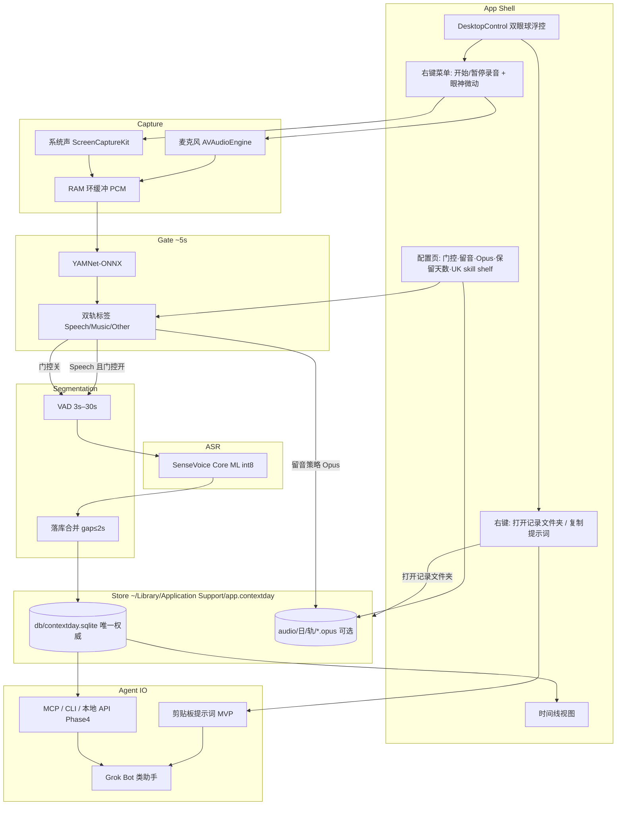

# ContextDay — 产品与技术 Spec

| 字段 | 值 |
|------|-----|
| 产品名 | ContextDay |
| Spec 文件 | `docs/01_spec.md` |
| Spec 版本 | **v0.3.29** |
| 状态 | Phase 0–4 §5 清单全部 `[x]`（**MVP SSOT**）；v0.3.29 PCM 环缓冲收紧（默认 B≈60s）+ A/B 开关；v0.3.28 VAD 自适应噪声底；正式公证/上架 **待人提交**。Agent IO post-MVP 见 [`docs/02_spec.md`](02_spec.md) |
| 创建时间 | 2026-10-28 23:13 Asia/Shanghai |
| 最后更新 | 2026-10-31 09:45 Asia/Shanghai |
| 目标平台 | macOS（计划独立上架 Mac App Store） |
| 主工程路径（Mac） | `/Users/ruska/projects/ContextDay` |
| 云端工作区 | `/workspace/ContextDay`（经 GitHub 同步，独立于 notta） |
| GitHub | 私有仓 https://github.com/jqlong17/ContextDay |

---

## 1. 项目背景

### 1.1 要解决什么问题

对话助手（Grok Bot 及同类产品）缺的是**本机、连续、带时间戳的生活上下文**。用户一天里说话、开会、听播客的内容，若不在本地沉淀，助手只能依赖当前对话窗口，无法回答「今早我说了什么」「下午会议里谁定了什么」。

ContextDay 定位为：**本机 24h 语音上下文采集与转写层**，把可检索的时间线（文本 + 可选音频）交给上层助手 / MCP / CLI，而不是做成又一个云端录音日记。

### 1.2 产品边界

| 做 | 不做（MVP） |
|----|-------------|
| 激活后持续采集（麦 + 可选系统声） | 通话录音 / 隐蔽录音叙事 |
| 本机分类门控 + SenseVoice Core ML int8 转写 | 云端 ASR 主路径 |
| 时间线日志、邻近段合并、本地查询 | 重度社交 / 习惯打卡（避免与 DayTrace 等品类混淆） |
| 配置：门控、留音频策略与体积预估 | 与输入法壳强绑定（独立 App） |
| 桌面拟物浮控 + 右键「打开记录文件夹 / 复制提示词（一行指针）」 | 另写每日转写 `.txt` 平行文件 |
| 向 Grok Bot 类产品暴露只读数据（MVP 剪贴板提示词；后续 MCP/API） | 替助手做推理与总结（可由上层做） |

### 1.3 命名与竞品注意

- 已弃用：DayTrace、VoiceTrace、单名 Context（商店与品类冲突）。
- 选定：**ContextDay**（副标可写「本机全天语音上下文 / For agents」）。
- 上架前仍需自行核对商标与域名注册。

### 1.4 已有实测依据（选型）

本机 Apple Silicon Mac（2026-10-28）对比结论写入飞书：[本机 ASR 选型对比（MacBook 友好视角）](https://my.feishu.cn/docx/T6Sdd8q1ZoHLn6xV5JOcPWxhnyh)。

- **生活日志长期后台**：SenseVoice **Core ML int8**（本进程约 20–36 MB；~11.7s 试音识别约 2.6s）。
- **短时听写**（非本产品主路径）：SenseVoice ONNX 更快但内存高峰约 800–900+ MB。
- **音频门控**：YAMNet-ONNX，约 5s 窗；麦 / 系统**双轨独立标签与独立送识决策**；Music 与 Speech 同高时 **Music 优先**（**仅作用于该轨本窗**）。系统轨判为 Music **不得**抑制麦轨采集或 ASR。
- **采集策略**：环缓冲连续采 PCM；分类只打标，不挡采集。PCM 仅作内存环缓冲 / 调试暂存，**不是**用户可选手动「全日留音」质量档。容量策略见 **§3.2.1**（默认 ≈60s/轨，非历史 ~10 min soft-cap）。

---

## 2. 产品设计

### 2.1 核心体验

1. 用户打开并**激活** ContextDay → 立即开始 24h 采集与（按策略）转写。默认**登录时打开**（`SMAppService.mainApp` Login Item，设置可关）；**首次**引导未完成时，球上方气泡引导说明 + 授权（§2.7.6）——冷启动**先**气泡、**绝不**在启动路径抢弹系统权限 / Login Item（权限只在气泡「授予权限」或之后设置 / 首次录音）；冷启动桌面球默认**醒来 idle + 眨眼/ready**（不进睡觉循环）；若权限与记录根就绪，播放 **ready** 动画一次作「一切正常」反馈（§2.7.4；首尾针，与录音 eye-click 分轨）。
2. 默认开启**分类过滤**：约每 5s 对环缓冲已有音频打标；仅判定为 **Speech** 的片段送入 SenseVoice Core ML int8。
3. 时间线展示：**起止时间 + 文本**；落库时对邻近碎片自动合并，避免过于零散。
4. 配置页可关过滤、可选择是否保留音频及质量；未开过滤时**只能保留全部音频**（不可选「仅人声」）。
5. 主交互为桌面拟物浮控（双眼 3D 球，见 §2.7）：左键在**未录音**时**开始**采集（可拖动浮控；录中左键不暂停）；右键菜单「开始录音 / 暂停录音」启停并播放眼神微动；同菜单亦可打开记录目录或复制给 AI 的提示词。

### 2.1.1 留音用途与默认策略（用户已确认）

保留音频的目的是：**事后抽查 / 回听某段作证据**（核对转写、调试门控），**不是** hi-fi 存档或音乐收藏。

| 规则 | 定稿 |
|------|------|
| 默认 | **`keep_audio` 关**；时间线以文本为主 |
| 开启后默认质量 | **Opus ~24 kbps**（人声可懂、体积适中） |
| 更小档 | **Opus 12 kbps**（~0.13 GB/天；更省空间） |
| 可选更高档 | **Opus 64 kbps**（仍非无损） |
| 不提供 | 全日 **WAV / PCM / 16-bit** 等作为用户可见留音预设（PCM 仅 RAM 环缓冲 / debug scratch） |
| 磁盘格式 | 本机落盘默认 **`.opus`**（见 §3.4） |
| 日后可选 | 单段 **导出**为 m4a/mp4 等——属导出能力，**不是**默认 on-disk 格式 |

### 2.2 配置项（MVP）

| 配置 | 默认 | 说明 |
|------|------|------|
| 分类过滤（YAMNet） | **开** | 关则所有达 VAD 门槛的段都送 ASR；留音频不可选「仅人声」 |
| 保留音频 | **关** | 开则落盘 Opus，并展示**预估 1 天占用**；用途见 §2.1.1 |
| 音频范围 | 仅人声 / 全部 | 仅人声依赖分类过滤开启 |
| 质量档 | 开留音时默认 **Opus 24 kbps**；另可选 **12** / **64 kbps** | 用户可见全日留音档**仅此三档**；**不提供** WAV/PCM/16-bit 预设（见 §2.4） |
| VAD | 静音结束约 1.5–2s；最短送识 **3s**；最长 **30s**；能量门限为**噪声底相对**（约 10th 百分位 ×3，封顶 0.02）+ 绝对下限约 **0.0035**（勿再用单一绝对 RMS 0.012） | 与「展示合并 gap」分开配置；连续有声逾最长须强制切段；utt=0 时 ~10s 诊断行附 rms/peak/voicedFrac |
| 合并 gap | **2s**（可配 1–3s） | 同轨、相邻段间隔 ≤ gap 则合并（见 §3.3） |
| 滚动保留天数 | **建议默认 30** | 可改；**nil = 不自动删**（仍提供手动清空）；设置里可发现 |
| 登录时打开 | **开**（Debug/dev 默认） | `SMAppService.mainApp` Login Item（macOS 13+）；设置 checkbox 可关；上架须保留用户关闭路径（见 §2.10） |

### 2.3 分段与合并

- **门控层（~5s）**：对**每一轨各自**的环缓冲窗打标，决定「本轨是否值得送 ASR / 是否按人声策略留音频」，**不**用 5s 硬切 ASR 句；**无跨轨 mute**（系统 Music ≠ 关麦）。
- **VAD 层**：每轨独立断句；最短 3s、最长 30s。能量门限优先相对噪声底（见 §2.2），避免安静 Mac/USB 麦在 48k→16k Int16 后因绝对 RMS 过高而 `inSpeech` 永不启动（无静音收尾、亦无 30s 强切 → 无 ASR）。开着的语音段逾 `maxSpeechMs` **必须**切出，即使全程有声、无静音。
- **落库合并**：同轨（mic / system）、重叠或相邻 gap ≤ **2s**（可配 1–3s）合并为一条；近同窗去重不拼接；细则见 §3.3.4。

### 2.4 磁盘粗算（写进配置文案）

按 16 kHz mono 粗算（全天 24h，未计门控命中率折扣）。配置文案应强调留音是**证据回听**、默认关、开则默认 24 kbps：

| 档位 | 约占用 / 天 | 说明 |
|------|-------------|------|
| Opus 12 kbps | ~0.13 GB | 更小档（可选） |
| Opus 24 kbps | ~0.26 GB | 开启留音时的**默认**档 |
| Opus 64 kbps | ~0.7 GB | 更高档（可选） |

「仅人声」再按门控命中率打折；上线后用真实占比校准区间。配置页粗算文案只展示上表三档（不列 WAV/PCM 对比行）。

采集管线仍会在 **RAM 环缓冲**中使用短时 PCM（及可选 debug 落盘 scratch），与上表全日留音档无关。单段导出 m4a/mp4 为日后可选能力，不改变默认 `.opus` 落盘。

### 2.5 给 Grok Bot 类产品的价值

- 本地可查询的「今天到现在」语音时间线（权威在 SQLite，**不**另写每日转写 txt）。
- 稳定 schema（时间、轨、文本、可选音频路径、分类标签）——与 §3.3 定稿一致；Phase 4 Agent IO 只读暴露同一模型。
- **MVP 轻量供数**：右键「复制提示词」把**一行指针**（`请阅读 {AGENT_SKILLS_ROOT}/README.md`）放进剪贴板；**不**把完整专有提示词正文写入剪贴板（见 §2.8）。
- 后续：本机 MCP / HTTP / CLI，只读为主，供对话助手拉取上下文。

### 2.6 隐私与系统边界（产品文案必写）

- **默认本地-only**：不上云；路径与删除方式在关于页 / 设置中可发现（具体布局见 §3.4）。
- 滚动保留与「删除今日 / 清空全部」均操作 Application Support 下 DB 与 `audio/`（见 §3.4 可删路径）。
- 权限：麦克风；系统声需 ScreenCaptureKit 等授权。
- 锁屏 / 睡眠边界（定稿）：**睡眠时停止采集，唤醒不自动续录**（须用户再次开始录音）。锁屏下麦轨在已授权且进程仍运行时可能继续；系统声依赖 ScreenCaptureKit，锁屏后可能中断。正式 24h 目标需保持 Mac 唤醒 / 接电源策略。详见 App「关于与隐私…」与 `docs/store-review-notes.md`。

### 2.7 桌面控制（双眼 3D 拟物球）

产品主壳是桌面上的**双眼 3D 拟物小球**（台球质感、双胶囊竖眼；与 Grok Bot 结合叙事）。用户已确认定稿艺术图与点击眼神微动 clip。

设计参考（**仅参考 / 备份，不作为唯一运行时路径**）：`design/icon-orb-eyes-v1.png`、`design/icon-orb-eye-click-2s.mp4`、`design/icon-orb-ready-2s.mp4`、`design/ref-icon-billiard.png`。早期 Bauhaus 圆角方钮探索（`design/btn-b-*`、`Resources/DesktopButton/`）已**废弃**，见下表。

#### 2.7.1 视觉资源

| 资源 | 路径 / Asset 名 | 说明 |
|------|-----------------|------|
| Idle（产品 + 桌面） | `Resources/DesktopOrb/idle.png`；Asset Catalog：`DesktopOrbIdle` | **透明背景** 1024 PNG；醒来 / 录制态静帧底图 |
| 睡觉循环（暂停后） | `Resources/DesktopOrb/sleep/fNN.png` | **Concept A**（闭眼 + 奶油色浮动 Zzz）；**首尾针**；`OrbFrameLoopPlayer` ~10fps；由 `scripts/generate_sleep_wake_assets.py` 从 `design/sleep-concepts/A-zzz.jpg` / `preview-sleep-A.mp4` 生成 |
| 起床（离开睡觉） | `Resources/DesktopOrb/wake-shy-S1.mov`（+ `.mp4` 绿幕源） | 约 **2s**；**A → S1（轻柔害羞腮红，无星星）→ idle**；运行时 `.mov` ProRes 4444 alpha |
| 点击眼神微动 | `Resources/DesktopOrb/eye-click-2s.mp4` / `.mov`；可拷入 Bundle | 约 **2s**；首帧=尾帧；仅眼神微动；用于**已醒**态开录；运行时 `.mov` |
| 冷启动就绪 | `Resources/DesktopOrb/ready-2s.mp4`（绿幕源）+ `ready-2s.mov`（rematte） | 约 **2s**；**首尾针**=`idle.png`；轻自信眨眼 / 提神；与 eye-click / wake **分轨** |
| App Icon 源图 | `Resources/AppIcon/icon-1024.png` → `AppIcon.appiconset` | **与 idle 同款艺术图**；导出各尺寸 |

| 废弃（已删） | `Resources/DesktopButton/` | 旧 Bauhaus 双态；已被 DesktopOrb 取代；仓库中已移除 |

MVP 视觉约定：

- **冷启动 / 未开过录**：默认醒来 `idle.png`（可叠 ready 眨眼），**不**进睡觉循环——保持与用户的互动感（§2.7.5）。
- **暂停录音之后**：立即进入 Concept A 睡觉循环（§2.7.5）；**不**播 eye-click。**录制中**：离开睡觉时播 wake S1，底下为醒来 `idle.png`（录制态额外光环 / 角标 = **二期可选**）。
- **开录反馈**：若当前在睡觉 → 播 `wake-shy-S1`（A→S1→idle）；若已醒（冷启动 idle / 录中再点菜单开录）→ 可播 `eye-click-2s`。播完 settle 到醒来 idle。
- **暂停反馈**：右键「暂停录音」→ **直接** `prefersSleepIdle=true` + `startSleepIdleLoop()`，**禁止**先播 eye-click。
- **不做**旧版「raised/pressed 双 PNG + 2px 下移」按压叙事。

#### 2.7.2 窗口层级（硬性要求）

桌面浮控窗口的 **window level 处于或低于普通窗口**，使 Safari / Chrome 等其它 App **可以遮盖**本浮控。禁止 `floating` / always-on-top / status-level 置顶。层级语义：**桌面最底层控件**，不是 HUD。

#### 2.7.3 交互（MVP）

| 操作 | 行为 |
|------|------|
| 左键 / 主键点击 | **未录音 / 已暂停**：单击 → **开始录音**；若在睡觉则播 wake S1，若已醒则播 eye-click。**正在录音**：左键**不**暂停、不切换、不播 clip（避免误关）。按住拖动仍可移动浮控（`isMovableByWindowBackground`；位移超过 ~4pt 视为拖动、不触发开始）。MVP：**录制中与 idle 视觉可相同**（二期再加录制态线索） |
| 右键 | 弹出上下文菜单（见下）；**暂停录音**仅由此（及睡眠停采）触发 |

右键菜单（MVP；**全部顶层扁平**，**禁止**「设置▾」或「调整大小」子菜单）：

| 分组 | 菜单项 | 行为 |
|------|--------|------|
| 录音 | **开始录音** | 开始采集；未在录制时可点；睡觉中 → wake S1，已醒 → eye-click |
| 录音 | **暂停录音** | 停止采集；正在录制时可点；**直接**进 Concept A 睡觉（不播 eye-click） |
| — | （分隔） | |
| 数据 | **打开记录文件夹** | Finder 打开**当前记录根**（可见 `db/` / `audio/`；无每日 txt） |
| 数据 | **复制提示词** | 将 §2.8 **一行指针**写入剪贴板（**不是**全文） |
| — | （分隔） | |
| 面板 | **设置…** | 打开**单一**配置窗（可滚动表单）：门控、留音/Opus、保留天数、系统声、**登录时打开**、**浮控大小**（48/64/80/96/128 pt，默认 64；切换时绕中心 ease-in-out ~0.28s）；**UK meeting skill shelf**（浏览 5 样式 / 示例预览 / 复制一行指针 / 查看技能全文）；另含「查看 Agent 全文…」只读 sheet（§2.8.2）。**不得**再嵌二级菜单 |
| 面板 | **时间线…** | 只读时间线（SQLite） |
| 面板 | **修改保存文件夹…** | `NSOpenPanel` → `recordsRootPath`；Store 重开 DB |
| 面板 | **关于与隐私…** | 路径、删除/保留、睡眠边界、Agent IO |
| — | （分隔） | |
| 退出 | **退出 ContextDay** | `NSApp.terminate` |

#### 2.7.4 冷启动就绪动画（all-good / ready）

冷启动（进程新建）在 Agent IO HTTP 绑定尝试完成之后，若同时满足：

1. 麦克风权限 = **authorized**
2. 屏幕录制权限 = **authorized**（`CGPreflightScreenCaptureAccess`；系统声 / SCK 所需）
3. 当前**记录根**可写（可创建目录树）

则桌面球调用 `playReadyOnce()`（优先 `ready-2s.mov`）**播一次就绪动画**，表示「权限与落盘都 OK / 一切正常」。规则：

- **每冷启动最多一次**；不得轮询每几秒再播。
- 未就绪时可短延迟再评一次（例如 +2s）；仍未就绪则本轮不播，不阻塞主流程。
- **专用 ready 轨**：与录音 eye-click **分轨**（资源与 API 分开）；二者共用同一 AVPlayer settle 基础设施（`playOrbClipOnce`）。若 Bundle 缺 `ready-2s.mov`，实现可回退到 eye-click 并打日志，但规格以专用 ready 为准。
- 就绪动画**不**启停录音。
- 左键开始录音的行为见 §2.7.3 / T22（就绪动画本身仍不因左键触发；左键仍按 T22 开录并播 eye-click）。
- **首尾针**：`ready-2s` 首帧=尾帧=`idle.png`（rematte 后）；播完 tear-down：冷启动默认回 keyed idle（眨眼互动）；仅当 `prefersSleepIdle`（例如暂停后）才回睡觉循环（§2.7.5）；若在录音 → keyed idle。

### 2.7.5 睡觉循环与起床（Concept A → S1 → idle；暂停后）

睡觉循环播放 `DesktopOrb/sleep/fNN.png`（**Concept A**：闭眼 + 奶油色浮动 Zzz；**首尾针**，`OrbFrameLoopPlayer`，约 10 fps）。**冷启动默认不进睡觉**——用醒来 idle / ready 眨眼体现互动（v0.3.21）；睡觉主要用于**暂停录音之后**（v0.3.22）。

规则：

1. **冷启动 / `show()`**：`prefersSleepIdle = false`；显示 keyed `idle.png`；就绪则播 §2.7.4 ready，settle 仍回 idle（不自动 `startSleepIdleLoop`）。
2. **暂停录音** / 用户主动停止采集：立即 `prefersSleepIdle = true` + `startSleepIdleLoop()`；**不**播 eye-click、**不**经其它过渡片。
3. **开始录音**（右键菜单或左键开录）且当前在睡觉：`stopSleepIdleLoop(resetUnderlayToIdle: false)`（保留末帧作底），播 `playWakeOnce()` → `wake-shy-S1.mov`（**A → S1 轻柔害羞腮红 → idle**）；settle 到醒来 idle。缺 wake 资源时可回退 eye-click 并打日志。
4. **开始录音**且已醒（未进过睡觉 / 冷启动 idle）：可叠播 eye-click；settle 到 idle。
5. **系统睡眠 / 退出停采**：同暂停路径（直进睡觉 / 停采），不播 clip。
6. **资源缺口**：若 Bundle 内 sleep 帧 < 2，则保持 keyed `idle.png` 静帧，并在 `Resources/DesktopOrb/sleep/README.md` 标明。生成脚本：`scripts/generate_sleep_wake_assets.py`；设计源：`design/sleep-concepts/A-zzz.jpg`、`design/wake-concepts/S1-soft-blush.jpg`；预览：`design/icon-orb-sleep-preview.mp4`、`design/preview-wake-shy-S1.mp4`。
7. 播放器 API（`OrbFrameLoopPlayer`）与目录约定独立于 `DesktopOrbView` 的 AVPlayer 片，便于其它帧循环复用。

验收：T21 / T26。

#### 2.7.6 首启引导气泡（onboarding）

冷启动时若 **尚未完成引导**（`UserDefaults` `onboarding_completed_v1`），在桌面球**上方**弹出**小气泡面板**（非远离的大模态），用对话口吻说明产品，再引导授权。就绪门是否已绿**不**用来跳过气泡（避免启动路径仍去同步 Login Item / 抢弹权限）。

规则：

1. **分段**：文案分 ≥3 段展示（职责 / 本机落盘与 Agent 可读 / 本地安全），**禁止**一次堆出全部长文。段间点「下一步」前进；第 2 段起提供「上一步」回到前段（第 1 段隐藏/禁用）；打字机可偏快；点「下一步」时可跳过当前段剩余打字。权限末页仍可「上一步」回到最后一段介绍（**不**因此触发 TCC）。
2. **位置 / 视觉**（v0.3.20 Concept A + v0.3.21 / **v0.3.26 跟随加固**）：气泡锚定浮控窗口上方；拖拽球时气泡须**实时跟随**并保持相对位置（居中、上方 `gapAboveOrb`）。**不可**只依赖拖拽结束后的 `didMove`，也**不可**在 `isMovableByWindowBackground` 拖拽中用可能滞后的 AppKit `frame` 去硬 `setFrame`（会把气泡拽回旧点）。实现：气泡作为浮控的 **`addChildWindow`**（Window Server 与球同步位移）+ 松手/布局变更时 reposition；非 child 时再以拖拽期轮询 / `CGWindowList` 实框兜底。**深色毛玻璃**（`NSVisualEffectView` `.hudWindow` + `.vibrantDark`）圆角卡片 + 朝下小尾巴；细浅描边 + 软阴影；紧凑内边距；正文奶油色**直接画在毛玻璃上**（禁止 `NSTextField` 另铺近黑实心底）；主 CTA 为柔和绿色胶囊「下一步」/「授予权限」，「上一步」/「稍后再说」为次要奶油色文字按钮。窗口层级与浮控同为 `.normal`（可被其它 App 遮盖）。禁止默认浅色 `NSPopover` / 纯白 `controlBackgroundColor` 卡片。
3. **权限步**：介绍结束后展示约 3–4 项清单——**登录时打开**（仅信息）、**麦克风**、**屏幕录制（系统声）**、**记录文件夹可写**。点「授予权限」依次触发真实系统请求：`SMAppService` / `AVAudioApplication.requestRecordPermission` / `CGRequestScreenCaptureAccess` / 确保记录根可写（必要时 `NSOpenPanel`）。权限只在「授予权限」/用户显式开录 / 设置触发（deferred TCC）；翻页「上一步」不请求权限。冷启动**仍**不得自动请求 TCC。
4. **录制必需 vs 信息项**（**v0.3.27**）：**麦克风**、**屏幕录制（系统声）**、**记录文件夹可写**为开录闸门；**登录时打开 / Login Item 永不阻挡主录制流**——缺 Login Item 只作清单信息，不阻止开始采集。就绪眨眼门（§2.7.4）仍可含屏幕/麦/可写，但 Login Item 不参与开录判定。
5. **对话化缺权 / 推迟**（**v0.3.27**）：
   - 「稍后再说」→ 气泡先回大约「好，那我暂时还不能完成录制；等你再次启用时我们再检查权限」，再 soft-close；**不**开始采集；仍标记 `onboarding_completed_v1` 以免每冷启动刷介绍。
   - 引导已完成后，用户左键球 / 右键「开始录音」时**再检查**录制必需权限；若仍缺 → 再弹出气泡，对话口吻点名缺失项（如「很遗憾，还有麦克风和屏幕录制（系统声）尚未开通，所以不能完成录制」），并可再点「授予权限」。
   - 录制必需均已就绪且用户要开录（或授予流程刚成功且带开录意图）→ 气泡可短说「那开始工作」后关闭并开始采集；首启授予成功无开录意图时短说「我先回到后台」后关闭并回 idle / 可播 ready。
6. **冷启动不抢戏**（v0.3.19 / **v0.3.21 收紧**）：引导**未完成**时，`applicationDidFinishLaunching` **不得**自动 `SMAppService.register` / 麦 TCC / 屏幕录制请求——**与就绪门是否已绿无关**。`mayAutoSyncSystemPreferences` 仅在 `onboarding_completed_v1` 为真时允许同步 Login Item；麦与系统声仍仅在「授予权限」或用户开始录音时请求。`PermissionStatus` 启动快照只读、不弹窗。
7. **完成**：标记 `onboarding_completed_v1`；关闭气泡；再评一次就绪门并可播 §2.7.4 ready（若已就绪）。
8. **实现**：`OnboardingFlow`（文案、`shouldPresent`、`mayAutoSyncSystemPreferences`、`PermissionFlags` / `canStartCapture` / 对话文案）+ `OnboardingBubbleController`（`OnboardingBubbleLayout` + `BubbleChromeView` 毛玻璃 + child-window 实时跟随 +「上一步」+ 对话 ack）+ `SoftGreenPillButton`；由 `DesktopControlController.considerOnboarding()` / `attemptStartRecording` 调用。

验收：T27 / T27b。

### 2.8 剪贴板索引与完整提示词（Agent IO 轻量路径）

> **v0.3.25**：设置单面板增加 **UK meeting skill shelf**（`category=uk-meeting`，`locale=en-GB`）：浏览 5 个稳定 id 样式、展示 skill 内 `## Example / Preview`、对选中技能复制一行「请阅读 {绝对路径}/{file}.md」。右键「复制提示词」仍默认指向 README。导出通道（Gmail/Docs/Word/本地文件）后续接线；**默认永不自动发邮件**。  
> **v0.3.9**：系统剪贴板**只**放一行「请阅读 …」路径指针；完整专有提示词 / 技能正文**仅**在设置只读 sheet 内展示，**禁止**经「复制提示词」或 `get_clipboard_prompt` 写出全文 / health / 工具列表 / 数据根长段。  
> **v0.3.6**：曾用多句「助手索引」；现已收短为一行指针（见上）。  
> **v0.3.4 起**：指针须指向本机 **Application Support** 技能绝对路径（Bundle `Resources/AgentSkills/` → `~/Library/Application Support/ContextDay/agent-skills/`）。剪贴板**不得**含仓库相对路径或 Spec 章节号。仓库 `docs/agent-skills/` 仍是 Git SSOT；**禁止**提交个人 Feishu/Lark chat_id / open_id。Agent IO /health 与工具细节写在 README / 全文 sheet，不进剪贴板。

#### 2.8.1 剪贴板一行指针（右键「复制提示词」+ `get_clipboard_prompt`）

运行时替换花括号为 Application Support 技能绝对路径；**仅一行**：

```text
请阅读 {AGENT_SKILLS_ROOT}/README.md
```

设置 UK shelf「复制提示词」或 `get_clipboard_prompt` 带可选 `name`（技能文件 basename）时：

```text
请阅读 {AGENT_SKILLS_ROOT}/{name}
```

`get_clipboard_prompt` JSON：`text` = 上一行；`kind` = `"index"`（README）或 `"skill"`（具名文件）。

#### 2.8.2 完整提示词（仅设置内只读查看）

设置窗提供 **「查看 Agent 全文…」**（通用操作简报）以及 UK shelf 的 **「查看完整提示词…」**（当前选中技能 markdown）→ modal/sheet，只读可滚动。**不得**提供「一键复制全文到剪贴板」按钮（用户仍可在 sheet 内手动划选复制，属 OS 文本选择；产品路径不以全文入剪贴板为目标）。

#### 2.8.3 UK meeting skill shelf（v0.3.25）

| id | file | title |
|----|------|-------|
| `uk-mom-detailed` | `uk-mom-detailed.md` | Detailed MoM |
| `uk-mom-brief` | `uk-mom-brief.md` | Brief |
| `uk-weekly` | `uk-weekly.md` | Weekly |
| `uk-monthly` | `uk-monthly.md` | Monthly |
| `uk-followup-email` | `uk-followup-email.md` | Follow-up email |

Frontmatter 必填：`id` / `title` / `version` / `category=uk-meeting` / `locale=en-GB`。共享硬规则：仅写可核对的 ContextDay 内容；含糊承诺标 TBC；无税/法结论；对外 UK English。与 UK landing / 共享 skill `uk-meeting-notes` 共用同一 catalog ids。

```text
你正在协助使用 ContextDay（本机 24h 语音上下文采集与转写层）。请只读访问下列本机转写数据，不要删除、移动或清空用户录音/数据库，除非用户在对话中明确要求并再次确认。

产品一句话：ContextDay 在 macOS 本机持续采集麦克风/可选系统声，经门控与 ASR 后把时间线写入 SQLite；转写权威在数据库，不另写每日 txt。

数据根目录（记录文件夹）：
{RECORDS_ROOT}

权威数据库：
{RECORDS_ROOT}/db/contextday.sqlite

可选留音（仅当用户开启 keep_audio）：
{RECORDS_ROOT}/audio/YYYY-MM-DD/{mic|system}/<segment-uuid>.opus

Segment 字段摘要：
id(UUID), track(mic|system), t0_ms/t1_ms(UTC epoch ms), tz_at_capture(IANA?),
text(转写), gate_label(speech|music|other?), audio_path(相对根路径?),
source_segment_ids, created_at_ms, merged_at_ms?, merge_gap_ms?,
asr_model_id?, asr_model_version?

本机 Agent IO（只读转写 + 可读写助手技能模版；仅 127.0.0.1）：
http://127.0.0.1:{AGENT_IO_PORT}/health
期望 JSON 含 "service":"ContextDay"。
转写工具：POST /v1/tools/{search_segments|get_recent|get_window|list_activity|list_speech_blocks|self_check}
（`list_speech_blocks` 与分轨 activity / ISO 派生见 docs/02_spec.md）
技能工具：POST /v1/tools/{list_agent_skills|get_agent_skill|update_agent_skill|reset_agent_skill|get_clipboard_prompt}
说明：get_clipboard_prompt / 右键「复制提示词」仅返回一行「请阅读 …/agent-skills/README.md」（可选 name 指向某一技能），不是本全文。

助手技能模版（本机可发现绝对路径；由 App Bundle 播种到 Application Support，可经 Agent IO 更新）：
{AGENT_SKILLS_ROOT}/README.md
{AGENT_SKILLS_ROOT}/meeting-minutes.md
{AGENT_SKILLS_ROOT}/daily-meeting-digest.md
{AGENT_SKILLS_ROOT}/feishu-minutes-lark-cli.md
{AGENT_SKILLS_ROOT}/meeting-notes-weekly-wiki.md
{AGENT_SKILLS_ROOT}/uk-mom-detailed.md
{AGENT_SKILLS_ROOT}/uk-mom-brief.md
{AGENT_SKILLS_ROOT}/uk-weekly.md
{AGENT_SKILLS_ROOT}/uk-monthly.md
{AGENT_SKILLS_ROOT}/uk-followup-email.md

建议做法：先 curl /health 确认 service=ContextDay；用 Agent IO 取 Segment 或 Read 上述技能文件；整理纪要遵循技能模版。不要假设存在每日转写 .txt。飞书相关占位符仅用本机私密配置，勿把真实 chat_id 写入仓库或公开回复。UK meeting 导出默认不自动发邮件。
```

其中 `{AGENT_SKILLS_ROOT}` = `~/Library/Application Support/ContextDay/agent-skills`（展开后的绝对路径）。

### 2.9 Agent IO 语义工具（首波定稿）

> **v0.3.2**：在 §2.8 剪贴板轻量路径之上，定稿**只读语义工具**表面，供本机 MCP / 本地服务 / 测试直接调用。字段与 §3.3 Segment 对齐；**不改 schema**。  
> **v0.3.4**：同层增加**助手技能**工具（读写 Application Support 副本；永不改 Bundle / Segment）。  
> **v0.3.8**：本 § 仍是 **MVP 航运合同**。分轨 `list_activity`、派生 ISO-8601、`list_speech_blocks`、统一错误与分页硬顶等 **post-MVP 优化**写在 [`docs/02_spec.md`](02_spec.md)；实现可随 02 合入，**不得**借机改 §3.3 Segment 表。

原则：

- **Segment 只读**：不得删除、移动、清空用户录音/数据库；不得改表结构。
- **权威在 SQLite**：返回转写文本来自 `Segment.text`，不假设每日 `.txt`。
- **技能可写（App Support only）**：`update_agent_skill` / `reset_agent_skill` 只动 Application Support；助手**无需** git checkout。
- **JSON 友好**：对外 DTO 使用 snake_case 字段名（见下）。
- **沙盒友好**：HTTP 仅 `127.0.0.1`。

#### 2.9.1 首波工具（必须实现 / stub 可查）

| 工具 | 参数 | 说明 |
|------|------|------|
| `search_segments` | `t0_ms?`, `t1_ms?`, `query?`, `track?`, `page?`, `max_chars?` | 按时间窗 + 可选关键词 / 轨检索；`page` 从 0；`max_chars` 可截断单段 `text` |
| `get_recent` | `hours?` **或** `limit?`, `track?` | 最近时段或最近 N 条；二者可只传其一，都缺则默认 `hours=24` |
| `get_window` | `t0_ms`, `t1_ms`, `track?` | 闭开或闭闭由实现注明；返回窗内全部段（可再受内部安全上限） |
| `list_activity` | `t0_ms?`, `t1_ms?` | 粗粒度活动摘要（按日/小时桶计数等）；无数据时返回空列表 |

每段对外字段（JSON；**snake_case**，稳定供 LLM tool calling）：

| 字段 | 类型 | 说明 |
|------|------|------|
| `segment_id` | string (UUID) | 对应 Segment.`id`（小写） |
| `t0_ms` / `t1_ms` | int64 | UTC epoch ms；`get_window` 按与 `[t0_ms, t1_ms]` **有交集**纳入（闭区间） |
| `track` | `"mic"` \| `"system"` | |
| `gate_label` | `"speech"` \| `"music"` \| `"other"` \| null | 可空 |
| `text` | string \| null | 转写；可被 `max_chars` 截断 |
| `tz_at_capture` | string \| null | IANA 时区（纪要本地墙钟）；可空 |
| `audio_path` | string \| null | 相对记录根；仅 keep_audio 有文件时非空 |

空库 / 无命中：**返回空数组**，不得崩溃。样例请求/响应见 `docs/agent-io-samples.md`。

#### 2.9.1b 助手技能工具（v0.3.4）

| 工具 | 参数 | 说明 |
|------|------|------|
| `list_agent_skills` | — | 列出 App Support `agent-skills/` 下 `.md` 与 `VERSION` |
| `get_agent_skill` | `name` | 读单个技能文件 |
| `update_agent_skill` | `name`, `content` | 覆盖 App Support 副本（packaged `.md` 或 `agent-skills.local.md`） |
| `reset_agent_skill` | `name?` | 从 Bundle 重置一个或全部 packaged；**跳过** `agent-skills.local.md` |
| `get_clipboard_prompt` | `name?` | 返回 §2.8.1 **一行指针**（无 `name` → README，`kind=index`；有 `name` → 该技能文件，`kind=skill`）；**不是**全文 |
| `self_check` | — | 只读诊断：权限快照、DB、模型文件、录音 UI/管线 desync、上次采集错误、Agent IO 监听 |

播种：启动时若缺文件或 Bundle `VERSION` 与 `.seeded-from-version` 不一致，从 Bundle 复制 packaged 文件；永不覆盖 `agent-skills.local.md`。

#### 2.9.2 非首波（明确不可用）

| 工具 | 状态 |
|------|------|
| `summarize_window` | **unavailable** — 不做本机摘要；留给上层助手 |
| `export_audio` | **unavailable** — 首波不导出音频字节 |

实现须对上述名称返回明确的「未实现 / 非首波」错误，避免静默空成功。

#### 2.9.3 承载

- 源码：`Features/AgentIO/`（服务 API + JSON DTO；HTTP + MCP stdio）；`Features/Diagnostics/`（`AppLog` / 权限 / `self_check`）；`Features/Store/AgentSkillsStore.swift`；Bundle `Resources/AgentSkills/`。
- MVP 仍保留 §2.8 一行指针剪贴板；全文仅设置内查看；样例见 `docs/agent-io-mcp.md`。

#### 2.9.4 诊断与日志（v0.3.6）

- **权限**：启动 / 打开设置 / 采集失败时记录 Microphone、Screen Recording（系统声）状态；Accessibility / Automation 若未使用则标 `not_applicable`（不伪造授权）。
- **日志**：`AppLog` → OSLog（subsystem `app.contextday` + category）；可选滚动文件 `{recordsRoot}/logs/contextday-YYYY-MM-DD.log`。info **不**写转写正文（可用 id / 字符数）。VAD 麦轨 ~10s 诊断在 `utt=0` 时附 `rms` / `peak` / `thr` / `noise` / `voicedFrac`（**禁止**写原始音频）。
- **自检**：`POST /v1/tools/self_check` 或 `./Scripts/contextday-cli.sh self_check`；`GET /health` 保持轻量（含 `recording_desync` / `last_capture_error`，完整报告走 `self_check`）。


---


### 2.10 登录项（Login Item）

| 项 | 定稿 |
|----|------|
| API | `SMAppService.mainApp`（macOS 13+；本工程 deployment ≥14） |
| 默认 | **开**（偏好 `open_at_login`；首装未写键时按默认开） |
| 设置 | 设置面板 checkbox「登录时打开（Login Item）」；保存时 `register` / `unregister` |
| 启动 | **仅**引导已完成（`onboarding_completed_v1`）时，`applicationDidFinishLaunching` 将偏好同步到 `SMAppService`；引导未完成则推迟——就绪门已绿也不在启动路径 register（§2.7.6 / v0.3.21） |
| 上架 | 用户**必须能关闭**；若系统返回 `requiresApproval`，引导在「系统设置 → 通用 → 登录项」批准（不静默失败） |
| 不做 | 隐藏 LaunchAgent / 无用户可控的常驻；不在未提示时反复弹系统批准 |


## 3. 技术架构设计

### 3.1 模块划分与源码树

| 模块 | 职责 |
|------|------|
| `App` | `@main`、生命周期；可选 AppDelegate / 菜单栏入口 |
| `Features/DesktopControl` | 浮控 `NSWindow`（层级见 §2.7.2）、`DesktopOrb` sleep 循环 + idle + eye-click + ready、首启引导气泡深色毛玻璃（§2.7.6）、右键菜单、剪贴板写入 |
| `Features/Capture` | 双轨采集（AVAudioEngine 麦 + ScreenCaptureKit 系统声）→ PCM 环缓冲（默认 60s/轨，A/B 见 §3.2.1） |
| `Features/Gate` | YAMNet-ONNX，~5s 窗；双轨独立标签与送识；Music>Speech 偏置仅限本轨本窗 |
| `Features/VAD` | 断句；min 3s / max 30s；噪声底相对能量门限 + 绝对下限；静音门槛与合并 gap 分离；utt=0 诊断附 rms/peak/voicedFrac |
| `Features/ASR` | SenseVoice Core ML int8（主力）；失败时明确降级策略（不默认偷开 ONNX） |
| `Features/Store` | SQLite 时间线、合并、可选 Opus 落盘；**唯一转写权威**；查询 API；**不**写平行 transcript txt；`AgentSkillsStore`（Bundle→App Support） |
| `Features/Config` | 门控 / 留音 / 质量 / 预估占用 / 滚动保留 UI；UK skill shelf（§2.8.3）；Agent 全文只读 sheet（§2.8.2） |
| `Features/Diagnostics` | `AppLog`、权限快照、`RuntimeHealth`、`SelfCheck` |
| `Features/AgentIO` | §2.9 Segment 只读 + 技能读写 + `self_check`；HTTP + MCP stdio；§2.8 一行指针 |
| `Resources` | `DesktopOrb/`、`AppIcon/`、`AgentSkills/`（打包技能模版）等 |

源码树草图（实现期可微调文件名，**模块边界与资源路径保持一致**）：

```text
ContextDay/
  App/                         # @main；AppDelegate / Menu 若有
  Features/
    DesktopControl/            # window、DesktopOrb sleep loop + idle + eye-click + ready、context menu、pasteboard
    Capture/
    Gate/
    VAD/
    ASR/
    Store/                     # SQLite + AgentSkillsStore；无每日 txt writer
    Config/                    # 设置 + UK skill shelf + Agent 全文只读 sheet
    Diagnostics/               # AppLog / 权限 / self_check
    AgentIO/                   # §2.9 语义工具 + HTTP / MCP
  Resources/
    DesktopOrb/
      idle.png                 # 透明 1024；产品 + 桌面
      sleep/fNN.png            # Concept A 暂停后睡觉；首尾针
      wake-shy-S1.mov/.mp4     # A→S1→idle 起床
      eye-click-2s.mp4/.mov    # ~2s 眼神微动；已醒开录
      ready-2s.mp4/.mov        # ~2s 就绪；首尾针=idle
    AppIcon/
      icon-1024.png            # 与 idle 同款 → Assets.xcassets/AppIcon.appiconset
    AgentSkills/               # 打包技能模版 → Application Support
  docs/
    01_spec.md                 # MVP SSOT
    02_spec.md                 # Agent IO post-MVP 优化轨
    agent-io-mcp.md            # HTTP / MCP / 技能工具 / Grok 样例
    store-review-notes.md      # 商店审核说明草稿
    agent-skills/              # Git SSOT 脱敏技能模板（与 Bundle 同步）
  Tests/                       # ContextDayTests (XCTest)
  Scripts/
    fetch-models.sh
    mac-verify.sh
    contextday-cli.sh
    pcm-buffer-ab.md            # PCM A/B 测量说明（v0.3.29）
    pcm-buffer-ab-sim.py        # Linux 容量比仿真
```

**资源引用**：Bundle `DesktopOrb/idle.png`（运行时 chroma-key）+ `sleep/` Concept A 帧循环 + `wake-shy-S1` + `eye-click-2s` + `ready-2s`（`.mov` 运行时 / `.mp4` 绿幕源）；`DesktopControl` 拥有窗口 level、点击播片与菜单；`Store` 拥有 SQLite 与可选 `audio/`；二者之间无平行转写文件通道。App Icon 源图与 `DesktopOrb/idle.png` 同艺术。`DesktopButton/` 已删除，勿再引用。

### 3.2 运行时原则

- **采集永不因分类延迟而停**；分类只标签已缓冲 PCM。
- **门控与 ASR 解耦**：Gate 决定 keep/transcribe；VAD 决定送模型切段。
- **本进程内存优先**：长期只留 Core ML；不把听写用 ONNX 绑进常驻路径。
- **轨语义**：过滤默认作用于「是否转写」；「全部保留音频」时非 Speech 仍可只存不转。
- **转写权威唯一**：Segment.`text` 只写 SQLite；禁止生成「每日转写 txt」作为产品路径。

#### 3.2.1 PCM 环缓冲容量与 A/B（v0.3.29）

**背景**：`PCMRingBuffer` 曾为可增长 `Data` + soft-cap `sampleRate*2*60*10`（~10 min Int16@16k），注释写明仅为 smoke-test 边界。识别路径只需约 40–60s 近期 PCM（VAD max 30s + 门控 ~5s + 余量）。用户机实测录音中 `phys_footprint` ~170–180 MB，`MALLOC_LARGE` ~115 MB（含缓冲 + ASR 堆）。

**产品决策（已批准）**：保留缓冲（VAD/ASR 需要）；去掉不必要的 ~10 min 软顶；优先真实固定容量环（或等价硬裁）。

| 变体 | 角色 | 容量 | 实现 |
|------|------|------|------|
| **A** | 对照（control） | ~**600s**/轨 soft-cap | 可增长 `Data`，顶满后 `removeFirst` + 推进 `streamStartMs`（旧语义） |
| **B** | 处理组 / **产品默认** | **60s**/轨 hard | 预分配固定环；覆写最旧样本并推进 `streamStartMs` |

**为何选 60s（非 45）**：`maxSpeech` 30 + gate ~5 + `silenceEnd` ~2 + process tick/pending ~2 + ASR/snapshot 滞后余量 ~21 ≈ **60**。落在 45–60s 目标带上沿，保证 30s 强切窗 + 门控窗始终留在环内。

**开关**（同包可翻，无需两套商店包；**改后须重启 App**）：

| 方式 | 键 / 旗标 | 说明 |
|------|-----------|------|
| UserDefaults | `pcm_buffer_variant` = `A` \| `B` | 主开关 |
| UserDefaults | `pcm_buffer_seconds` | ≥300 → A；(0,300) → B |
| 编译期 | `-DCONTEXTDAY_PCM_VARIANT_A` / `_B` | `OTHER_SWIFT_FLAGS`；优先于 UserDefaults |
| 默认 | **B** | 指标失败时可用 A 回滚，勿在未测过时改回默认 A |

麦 / 系统**双轨各一**缓冲，互不共享存储。指标日志约每 30s：`pcm_ab … filledBytes/peakBytes/sum*`（无原始音频）。

**成功指标（B 胜出 / 可默认 B）**：

| Metric | 量法 | Pass |
|--------|------|------|
| Peak PCM buffer bytes（每轨 + sum） | 仪器 `filled`/`capacity`/`peak`；A 需写满 soft-cap（≥10 min）或 XCTest harness；短跑仅观察 B 是否 plateau@60s | B ≤ A × 0.15（约 10×） |
| Process `phys_footprint`（录 3 min，闲聊+安静） | 同机同包 `footprint -p` / Activity Monitor | B ≤ A − 20 MB **或** B ≤ 150 MB（取更严且可达） |
| 转写质量代理 | 同一 ~60s 连说+短停；非空 text 段数；无长时间「在说却 utt=0」 | B 段数在 A ±20%；30s 强切不回退 |
| Correctness | `PCMRingBufferTests` 等 XCTest | 0 failures |

Linux CI 只验证容量比与 XCTest 逻辑；**Mac footprint A/B 由父机安装后实测**。测量步骤见 [`Scripts/pcm-buffer-ab.md`](../Scripts/pcm-buffer-ab.md) 与 `Scripts/pcm-buffer-ab-sim.py`。

假设（非绑定）：`MALLOC_LARGE` 主要随更小 PCM + 更小 snapshot 下降；ASR Core ML 堆大体不变。

### 3.3 数据模型（定稿）

本机 SQLite（Swift 侧类型约定见下）为**唯一转写与时间线权威**；Phase 4 Agent IO **只读**暴露同一 schema，不做平行云端实体，也**不**做每日 txt 投影。

#### 3.3.1 时间与 ID 编码

| 约定 | 选择 | 说明 |
|------|------|------|
| 主键 / 外键 | **UUID**，存 TEXT（标准 8-4-4-4-12 小写） | Swift `UUID` ↔ SQLite TEXT |
| 绝对时间 | **Unix epoch 毫秒**（`INTEGER`，UTC） | `t0_ms` / `t1_ms` / `created_at_ms`；展示时按设备或 `tz_at_capture` 转本地 |
| 时区策略 | 落库存 **UTC ms** + 可选 **`tz_at_capture`**（IANA，如 `Asia/Shanghai`） | 避免「只有本地墙钟字符串」导致跨时区歧义；UI 默认按捕获时区显示起止 |
| 不采用 | ISO-8601 字符串作主键时间 | 查询区间与合并比较用整数 ms 更稳；Agent 导出时可派生 ISO-8601 |

#### 3.3.2 `gate_label` 枚举

与 YAMNet 门控用法对齐（Music 与 Speech 同高时 **Music 优先**，见 §1.4）：

| 值 | 含义 |
|----|------|
| `speech` | 判定为人声（默认可送 ASR；「仅人声」留音命中） |
| `music` | 判定为音乐（含 Music>Speech 偏置后的结果） |
| `other` | 其余（噪声、环境声、不确定等，MVP 不细拆） |

落库字段为 TEXT，仅允许上表三值。合并后的 `gate_label`：若源段不全相同，取**时间最长**的源段标签；并列则优先 `speech` > `music` > `other`（便于时间线检索人声）。

#### 3.3.3 `Segment`（时间线条目）

| 字段 | 类型（Swift / SQLite） | 必填 | 说明 |
|------|------------------------|------|------|
| `id` | `UUID` / TEXT | 是 | 段主键 |
| `track` | enum / TEXT | 是 | `mic` \| `system` |
| `t0_ms` | `Int64` / INTEGER | 是 | 段起始（UTC epoch ms） |
| `t1_ms` | `Int64` / INTEGER | 是 | 段结束（UTC epoch ms）；须 `t1_ms > t0_ms` |
| `tz_at_capture` | `String?` / TEXT | 否 | 捕获时 IANA 时区；缺省则展示用系统当前时区 |
| `text` | `String?` / TEXT | 否 | 转写文本；合并后为拼接结果（**仅存库，不写 txt**） |
| `gate_label` | enum / TEXT | 否 | 见 §3.3.2；门控关且未打标时可空 |
| `audio_path` | `String?` / TEXT | 否 | **相对** Application Support 根的路径（见 §3.4）；无留音则空 |
| `source_segment_ids` | `[UUID]` / TEXT(JSON 数组) | 否 | 合并前碎片 id；未合并则为空数组或仅含自身（实现任选一种，查询层统一） |
| `created_at_ms` | `Int64` / INTEGER | 是 | 本行首次写入时间（UTC ms） |
| `merged_at_ms` | `Int64?` / INTEGER | 否 | 最近一次合并写入时间；未合并为空 |
| `merge_gap_ms` | `Int?` / INTEGER | 否 | 促成此次合并时使用的 gap 阈值（毫秒）；未合并为空 |
| `asr_model_id` | `String?` / TEXT | 否 | 如 `sensevoice-coreml-int8` |
| `asr_model_version` | `String?` / TEXT | 否 | 模型包版本或构建标识；廉价落库便于日后复盘 |

索引建议：`(track, t0_ms)`、`(t0_ms)`；全文检索二期再定。

#### 3.3.4 合并规则（定稿）

1. **同轨**：仅 `mic` 与 `mic`、或 `system` 与 `system` 可合并。
2. **间隙 / 重叠**：两段区间的分离距离（不重叠时为中间空隙；重叠或相接为 0）**≤ `merge_gap_ms`** 则合并。`merge_gap_ms` 默认 **2000**，用户可配 **1000–3000**（与 §2.2 一致）。重叠视为可合并（等价于 gap &lt; 0）。
3. **邻域查找（v0.3.23）**：落库时在同轨、时间邻域内找最佳合并对象（优先重叠最大 / 近同窗，其次空隙最小），**不得**只与「`t0_ms` 最新一行」比较——否则晚到的同窗重送识会插成新行。
4. **近同窗去重（v0.3.23 / v0.3.24）**：
   - **落库**：若两端点均在 **500ms** 内，或重叠 / min(时长) ≥ **80%**，视为同一句的重复窗：合并时间并集，**文本取较长非空**（**不**拼接），避免 ASR 微差连成「假长句」。
   - **采集送识 single-flight（v0.3.24）**：按墙钟 `[t0,t1]` 记录已送识窗（环缓冲裁切后 sample 下标会漂，不能再靠 sample±800）。判定「已送过」用：**两端点 slop≤500ms**，或 **IoU≥90%**，或 **重叠 / 候选时长 ≥80%**（候选窗已被先前窗盖住）。**禁止**用重叠/min(时长) 做送识去重——短窗先发出后，加长 refinement 会被误杀，表现为录音中说话却长时间无 gate/ASR/落库。
5. **时间**：合并后 `t0_ms = min(...)`，`t1_ms = max(...)`。
6. **文本（非近同窗）**：按时间序拼接；**段间不加空格/换行**（中文生活日志优先；英文粘连可接受，二期再加智能空格）。空 `text` 跳过。合并结果文本软顶 **8000** 字。
7. **音频（MVP 定稿）**：若多段均有 `audio_path`，**保留最早一段（按 t0_ms）的文件**，更新合并行的 `audio_path`；其余文件标为孤儿并**调度删除**。拼接成新 Opus = **后期**能力，不进 MVP。仅一段有音频则继承该路径。
8. **`source_segment_ids`**：合并后为所有被并入碎片 id 的并集（若碎片本身已是合并结果，则展平为其 `source_segment_ids`，避免嵌套）；软顶 **32** 个 id。
9. **ASR 元数据**：`asr_model_id` / `asr_model_version` 取**最后一段**（`t1_ms` 最晚）的非空值。

#### 3.3.5 伴生类型（MVP 最小）

**`AppConfig`（偏好快照，非云同步）** — 存 **UserDefaults**（见 §3.4），不进 Segment 表：

| 字段 | 类型 | 默认 | 说明 |
|------|------|------|------|
| `gate_enabled` | Bool | true | 分类过滤 |
| `keep_audio` | Bool | **false** | 是否落盘 Opus（证据回听；默认关） |
| `audio_scope` | enum | `speech_only` | `speech_only` \| `all`；`gate_enabled=false` 时强制 `all` |
| `audio_quality` | enum | **`opus_24`** | **仅** `opus_12` \| `opus_24` \| `opus_64`；无 wav/pcm 枚举值 |
| `merge_gap_ms` | Int | 2000 | 1000…3000 |
| `retention_days` | Int? | **建议默认 30** | 滚动保留天数；**nil = 不自动删**（仍提供手动清空）；设置里可改 / 可发现 |

**日 / 会话索引**：MVP **不**单独建 Day/Session 表。日历「某日」由本地时区下 `t0_ms` 落在该日的 Segment 查询派生。Phase 4 若需汇总，再加只读视图，不引入同步实体。

#### 3.3.6 Agent IO（Phase 4）约定

只读查询返回与上表字段同名的 JSON（时间用 epoch ms；可另附派生 ISO-8601 字段，但不替代权威 ms）。不另起一套 schema。MVP 阶段用 §2.8 剪贴板提示词作为轻量供数；Phase 4 再接 MCP/HTTP/CLI。

### 3.4 本机数据目录（定稿）

#### 3.4.1 根路径

计划 Bundle ID：`app.contextday`（Phase 0 Xcode 骨架锁定；若商店要求改 ID，只改根目录名，相对布局不变）。

```text
~/Library/Application Support/app.contextday/
├── db/
│   └── contextday.sqlite          # 时间线与转写唯一权威（Segment 等）
├── audio/                         # 仅可选留音（keep_audio=true；默认 .opus）
│   └── YYYY-MM-DD/                # 见 §3.4.5 日界规则
│       ├── mic/
│       │   └── <segment-uuid>.opus
│       └── system/
│           └── <segment-uuid>.opus
├── logs/                          # 可选诊断日志（滚动，可关）
│   └── contextday-YYYY-MM-DD.log
└── scratch/                       # 可选：短时 debug PCM / 崩溃残留；默认空；可进「清除缓存」
```

**明确不做**：在日目录或别处写入转写 `.txt` / 「每日记录文本」。转写只在 `db/contextday.sqlite` 的 `Segment.text`。

关于页 / 设置须展示：**Application Support 根路径**（可「在 Finder 中显示」；与右键「打开记录文件夹」同一路径），并说明默认不上云。日后若支持「导出片段为 m4a/mp4」，导出文件由用户另选位置，**不**写入上述 `audio/` 默认树。

#### 3.4.2 配置 vs 文件

| 数据 | 位置 | 说明 |
|------|------|------|
| 用户偏好（§3.3.5 `AppConfig`） | **UserDefaults**（`app.contextday` suite） | 不把开关写进 SQLite，避免与时间线备份混淆 |
| 时间线 / 转写 Segment | `db/contextday.sqlite` | **唯一权威**；无平行 txt |
| 可选音频 | `audio/…/*.opus` | `Segment.audio_path` 存相对根路径，如 `audio/2026-10-28/mic/<uuid>.opus` |

#### 3.4.3 模型

- **优先 App Bundle 内置**（SenseVoice Core ML int8、YAMNet-ONNX 等）。
- **不要求** Application Support 下可写 `models/`；仅当日后支持「应用内下载/更新模型」时再增设可写目录，并在隐私说明中单列。

#### 3.4.4 滚动保留与可删路径（供 §2.6 / 设置文案引用）

| 操作 | 影响路径 |
|------|----------|
| 按 `retention_days` 滚动删除 | 删除早于阈值的 Segment 行 + 对应 `audio/YYYY-MM-DD/**`；空日目录可回收 |
| 删除某日 | 该日 Segment + `audio/YYYY-MM-DD/`（若存在） |
| 清空全部上下文 | `db/contextday.sqlite`（重建空库）+ 清空 `audio/` |
| 清除缓存 / 日志 | `scratch/`、`logs/`（不影响时间线） |

磁盘将满时：优先停新留音并提示；转写可降级为只写文本（与 §3.5 一致）。

#### 3.4.5 `audio/YYYY-MM-DD/` 日界规则

- 日目录名用**本地日历日**：优先 `tz_at_capture`（IANA）；缺省则用**系统当前时区**。
- 一段若跨午夜：仍为**一行** Segment；音频文件落在 **`t0_ms` 所在本地日历日**目录下（不按 t1 切文件）。

### 3.5 失败与降级

| 故障 | 行为 |
|------|------|
| Core ML 加载失败 | 提示；停转写或用户显式选降级（不静默上 ONNX） |
| YAMNet 失败 | 按配置：等同关闭过滤，或安全停写并提示 |
| 权限被拒 | 激活失败；引导系统设置 |
| 磁盘将满 | 停留音 / 滚动删除；转写可降级为只写文本（仍写 SQLite，不改写 txt） |

---

## 4. 技术架构拓扑图



---

## 5. 开发任务执行计划

### Phase 0 — Spec 与工程骨架（当前）

- [x] 产品命名 ContextDay；弃用冲突名
- [x] 本目录与 `docs/01_spec.md`
- [x] 数据目录与 schema 定稿（v0.2.0）
- [x] 桌面浮控 / 右键与剪贴板提示词写入 Spec（v0.3.0）
- [x] 双眼 3D 球定稿：`DesktopOrb/idle.png`、`eye-click-2s.mp4`、`AppIcon/icon-1024.png`；Spec → v0.3.1
- [x] 打包 `DesktopOrb/`（idle + eye-click）；idle 走 Bundle PNG + 运行时 chroma-key（不依赖 Assets `DesktopOrbIdle`）
- [x] App Icon：`AppIcon.appiconset` 自 `icon-1024.png` 导出各尺寸（炭灰不透明底）
- [x] Xcode / SPM 工程骨架、bundle id `app.contextday`、权限 plist / entitlements
- [x] Spec v0.3.2 §2.9 Agent IO 语义工具首波定稿
- [x] 废弃 `DesktopButton/`：仓库中已无该目录；源码树说明保留「勿再引用」

### Phase 1 — 采集 + 门控 + 桌面壳 MVP

- [x] 双轨采集 + 环缓冲（mic AVAudioEngine + 可选 ScreenCaptureKit 系统声）
- [x] YAMNet 5s 双轨标签 + Music 优先（`decideLabel`；ONNX 需 `Scripts/fetch-models.sh`）
- [x] DesktopControl：`.normal` 窗口、冷启动 orb idle/blink；左键未录音时开始录音（录中不关；拖动可移动）；右键菜单开始/暂停 + eye-click；首启气泡引导 + child-window 拖拽跟随 +「上一步」/「下一步」+ 麦/屏幕/登录项/文件夹权限；Login Item 不挡开录；缺必需权限对话再提示（§2.7.6）
- [x] 登录项 `SMAppService.mainApp` + 设置开关（默认开）；冷启动就绪 `ready-2s` 一次（§2.7.4）
- [x] 右键扁平：打开记录根；复制 §2.8 提示词；开始/暂停录音；设置…（单面板含浮控大小）/时间线/修改保存文件夹/关于与隐私；无设置子菜单
- [x] MVP 录制态可与 idle 同视觉；录制态额外线索（光环等）= 二期

### Phase 2 — ASR + 时间线

- [x] SenseVoice Core ML int8 接入（失败明确报错；禁止静默 ONNX ASR）
- [x] VAD 3–30s + 落库合并（多段音频保留最早文件；XCTest 覆盖）
- [x] 时间线 UI（时间点 + 文本；读自 SQLite）
- [x] 配置单面板：门控开关、留音、Opus 质量、预估占用、仅人声/全部约束、`retention_days`（默认 30）、系统声开关、登录时打开（Login Item）、浮控大小（ease-in-out）

### Phase 3 — 稳固与商店向

- [x] 锁屏/睡眠行为说明：睡眠停采且唤醒不自动续录；关于页 + §2.6 定稿；`willSleep` 观察者
- [x] 磁盘滚动（`RetentionPurger` + `retention_days`）与爆盘保护（`DiskSpaceGuard` 停留音）
- [x] 隐私文案、本地路径、删除策略（「关于与隐私…」+ Info.plist usage）
- [x] App Store / 公证审核说明草稿（`docs/store-review-notes.md`）；**正式公证仍待提交时执行**

### Phase 4 — Agent 供数（完整接口）

- [x] 本地 HTTP JSON（`127.0.0.1:18787`（空闲回退 18787–18797））挂 §2.9 四工具；剪贴板 MVP 仍可用
- [x] MCP stdio 传输（`ContextDay --mcp`，无第三方 SDK）+ `Scripts/contextday-cli.sh`
- [x] 查询：按时间范围 / 关键词 / 轨（`search_segments` / `get_window` / `get_recent` / `list_activity`）
- [x] XCTest：`ContextDayTests`（merge / Agent IO / YamNet bias / SenseVoice load-skip / retention）
- [x] 与 Grok Bot 类产品对接样例（`docs/agent-io-mcp.md` + §2.8 提示词）

---

## 6. 测试用例（草案）

| ID | 场景 | 步骤要点 | 期望 |
|----|------|----------|------|
| T01 | 激活即采 | 授权后右键 → 开始录音 | 环缓冲有 PCM；播放 eye-click 后 settle；UI 显示记录中（MVP 球可仍为 idle） |
| T02 | 门控开 + 说话 | 对麦说话 ≥3s | 出现 Speech 标签；SQLite 产生转写条目 |
| T03 | 门控开 + 纯音乐（系统轨） | 本机放歌（麦安静） | **系统轨** Music 优先、默认不送 ASR；**麦轨不受影响**（无跨轨 mute） |
| T04 | 门控关 | 关过滤后说话/放歌 | 达 VAD 的段均可送 ASR；留音不可选仅人声 |
| T05 | VAD 最短 | 极短爆破音 | 不足 3s 不落转写 |
| T06 | VAD 最长 | 连续说 >30s（可无静音） | 约 30s 强制切段并送识 |
| T06b | VAD 安静麦 | 安静房底 + 轻声对话（RMS≪0.012） | 仍断句 utt>0；纯静音不发；utt=0 时日志含 rms/peak/thr/voicedFrac |
| T07 | 合并 | 两句间隔 ≤2s | 时间线一条；起止覆盖两端 |
| T08 | 碎段 | 间隔 >2s | 两条独立 |
| T09 | 留音预估 | 开留音并切换 Opus 12/24/64 | 默认关；开后默认 24；预估与 §2.4 同量级；无 WAV/PCM 全日档 |
| T10 | 仅人声留音 | 门控开 + 仅人声 | 非 Speech 不写音频文件 |
| T11 | 门控关 + 仅人声 | 试图勾选仅人声 | UI 禁用或强制「全部」 |
| T12 | Core ML 失败 | 移走模型 | 明确错误；不静默切 ONNX |
| T13 | 权限拒绝 | 拒麦 | 无法激活；可跳转设置 |
| T14 | 双轨同时 | 麦说话 + 系统放歌 | 两轨标签独立；系统 Music **不**跳过麦 Speech ASR；日志含 `per-track gate track=… scope=this_track_only` |
| T15 | 内存 | 记录 1h | 本进程内存保持 Core ML 档；PCM 默认 B（≤60s/轨），见 §3.2.1 / T28 |
| T28 | PCM 缓冲 A/B | `defaults write … pcm_buffer_variant A` 与 `B` 各录；对读 `pcm_ab` peak + footprint + 同脚本段数 | B peak ≤ A×0.15（A 写满 soft-cap 时）；footprint / 质量见 §3.2.1 表；XCTest 绿 |
| T16 | 浮控层级 | 浮控（orb）可见时打开浏览器全屏/前置窗口 | 浏览器**可遮盖**浮控；非 always-on-top |
| T17 | 打开记录文件夹 | 右键 → 打开记录文件夹 | Finder 打开 Application Support 根；可见 `db/`（及可选 `audio/`）；**无**要求存在每日 txt |
| T18 | 复制提示词（一行指针） | 右键 → 复制提示词 → 粘贴 | 仅 `请阅读 …/agent-skills/README.md`；**无** health/工具列表/sqlite 长段 / Segment 字段摘要 / 完整专有正文 |
| T18b | 设置内看全文 | 设置 → 查看 Agent 全文… | sheet 只读可滚动展示 §2.8.2 全文；不自动写入剪贴板 |
| T18c | UK skill shelf | 设置 → UK meeting skill shelf 选样式 → 预览示例 → 复制提示词 | 剪贴板仅一行「请阅读 …/uk-*.md」；「查看完整提示词…」只读展示该 skill；不自动发邮件 |
| T18c | self_check | CLI / HTTP `self_check` | JSON 含 permissions、database、models、recording_desync；可无 UI |
| T19 | 无 txt 落盘 | 激活并产生至少一条转写后扫盘 | Application Support 下**无**转写用途的 `.txt`；文本仅在 sqlite |
| T20 | 合并留最早音 | keep_audio 开；两段均有 opus 且间隔 ≤gap | 合并后 `audio_path` 指向最早段文件；孤儿文件被调度删除 |
| T21 | 开录 / 暂停动画 | 右键 → 开始录音（已醒 / 睡觉中各一次）；右键 → 暂停录音 | 已醒开录：约 2s eye-click；睡觉中开录：wake S1（A→腮红→idle）；**暂停：无 eye-click，直接 Concept A 睡觉循环**；球身无明显缩放/位移 |
| T22 | 左键开始录音 | 未录音时左键单击浮控；录中再左键单击；按住拖动 | 未录音：开始采集并播放 eye-click；录中：不暂停、不切换、不播 eye-click；拖动（位移≳4pt）可移动浮控且不误触开始 |
| T23 | 调整大小动画 | 右键 → 设置… → 浮控大小，在两档 pt 间切换 | 浮控绕中心平滑缩放（约 0.28s ease-in-out），**不**瞬时跳变；层级仍为 `.normal`；暂停仍仅右键；右键**无**大小子菜单 |
| T24 | 登录项开关 | 设置 → 登录时打开 开/关 → 保存；查看系统登录项 | 开：`SMAppService` enabled 或 requiresApproval；关：notRegistered；偏好与服务一致 |
| T25 | 就绪动画 | 冷启动；mic+屏幕录制已授权且记录根可写 | Agent IO 绑定后 orb 播 **ready-2s 一次**（非录音 eye-click）；同一次进程内不再因轮询重复；就绪动画本身不启停录音；左键开录仍见 T22 |
| T26 | 睡觉 / 起床 | **冷启动**醒来 idle（可 ready 眨眼），**不**自动睡觉；**暂停**直进 Concept A（闭眼+奶油 Zzz）；再开录播 S1 起床后 settle idle | 冷启动互动 idle/blink；暂停无 eye-click；可见 Zzz 循环；起床见害羞腮红、无星星；缺帧时静帧 idle + README |
| T27 | 首启引导气泡 | 清除 `onboarding_completed_v1`；冷启动 | 冷启动**不**先弹 Login Item / 麦 / 屏幕（门已绿也不弹）；球上方气泡分段打字 +「下一步」/「上一步」（首页无上一步；权限页可回介绍）；拖拽球时气泡实时跟随（child-window）；正文无近黑实心底；末段后权限清单；「授予权限」才触发真实 TCC / Login Item / 可写目录；完成后标记完成且不再每冷启动重复；可随后 ready（T25） |
| T27b | 权限气泡对话化 | 引导完成后缺麦/屏幕/可写；或点「稍后再说」；仅缺 Login Item | 「稍后再说」→ 推迟文案后 soft-close、不开采；左键/开录在缺必需权限时再弹气泡点名缺失项并可再授予；**仅缺 Login Item 仍可开录**；必需齐备后短「那开始工作」再开录 / 首启成功可「我先回到后台」 |

---

## 7. 验收标准（MVP）

1. 激活后可持续采集 ≥ 8h 不崩溃（开发机冒烟）；正式目标 24h。
2. 默认门控下：明显音乐段不产生转写；清晰人声段有文本与时间戳。
3. 时间线无「一秒一条」式碎到不可读；合并规则符合 gap≤2s；多段音频合并保留最早文件。
4. 配置**单面板**齐全：门控、留音与 Opus 质量+日占用预估、仅人声/全部（约束正确）、滚动保留（建议默认 30，可 nil）、登录时打开、浮控大小；留音默认关、开则默认 24 kbps；**无** WAV/PCM 全日留音选项；右键无设置/大小子菜单。
5. 主力 ASR 为 SenseVoice Core ML int8；文档与关于页写明本机推理。
6. 隐私：默认不上云；Application Support 路径与删除方式可查（§3.4）。
7. 命名与商店素材使用 ContextDay，不与输入法产品混品牌。
8. 桌面浮控：透明 idle 双眼球；未录音左键开始 + eye-click ~2s；录中左键不关；右键可开始/暂停；设置面板内「浮控大小」平滑缩放；窗口可被其它 App 遮盖；`icon-1024.png`（同 idle）可作 App Icon；MVP 录制态可与 idle 同视觉。
9. 右键「打开记录文件夹」打开记录根；「复制提示词」符合 §2.8.1 一行指针；全文仅 §2.8.2 设置内查看；转写**仅**在 SQLite，无每日 txt 要求。
10. 登录项：设置可开关；默认开时登录后应拉起 App（或进入 `requiresApproval` 待用户在系统设置批准）；关闭后不再自动登录启动。
11. 冷启动就绪：mic + 屏幕录制 + 记录根可写时，orb **仅一次** `ready-2s`；未就绪不播、不刷屏；与录音 eye-click 分轨。
12. 首启引导：权限未就绪时球上方气泡分段说明 + 权限清单；完成后不每冷启动重复刷屏；缺录制必需权限再开录时对话化再提示；Login Item 不挡开录（§2.7.6 / T27 / T27b）。

---

## 8. 备忘录

- 门控 5s 与 VAD 切段是两级，不要合成一个旋钮。
- VAD 能量门限勿回到单一绝对 RMS 0.012；安静 Mac/USB 麦会 `utt=0` 饿死 ASR。优先噪声底相对 + 绝对下限；连续有声必须 max 强切。
- PCM 环默认 **B=60s/轨**（§3.2.1）；勿再把 ~10 min soft-cap 当产品需要。回滚对照用 `pcm_buffer_variant=A`；Mac footprint 须父机按 `Scripts/pcm-buffer-ab.md` 复核后再宣布内存结论。
- 留音默认关；开则默认 Opus 24，可选 12 / 64——为证据回听而非 hi-fi；禁止全日 WAV/PCM 预设；m4a/mp4 仅作日后导出。
- 审核叙事：用户显式激活的本机上下文工具，服务个人助手；非隐蔽监控。
- 与既有 YamnetGate / AsrCompare 实验代码可参考，但 ContextDay 工程独立，避免绑听写 ONNX 生命周期。
- 中文连续数字 Core ML 仍可能弱于 ONNX；生活日志可接受，需在已知问题中披露。
- **已知限制**：Music>Speech 偏置可能导致**同一轨**上「有 BGM 的说话」被标成 music 而不送 ASR（例如麦拾到外放音乐+人声）；须在产品已知问题 / 设置说明中披露，不可静默。这**不是**跨轨抑制：系统轨 Music 不关麦轨。
- Agent IO：§2.8 剪贴板 + HTTP `18787–18797` + MCP stdio（`--mcp`）共用 `AgentIOProtocol.dispatch`（Segment 只读 + 技能 App Support 可写）。Schema 自 v0.2.0 定稿；v0.3.x **未改** Segment 字段列表。
- 产品图标：v0.3.1 起以双眼 3D 球为准；`DesktopButton/` 已从仓库移除，勿再引用。
- 登录项：只用 `SMAppService.mainApp`；勿改用隐藏 LaunchAgent。就绪用 `playReadyOnce`（`ready-2s.mov`）；已醒开录用 `playEyeClickOnce`；离开睡觉用 `playWakeOnce`（`wake-shy-S1.mov`）；暂停直进睡觉、不播 eye-click；每冷启动就绪 ≤1 次。
- 首启气泡：`OnboardingFlow` + `OnboardingBubbleController`（Concept A 深色毛玻璃 + 柔绿胶囊，v0.3.20；拖拽 child-window 实时跟随 +「上一步」+ 正文无黑底，v0.3.26；对话化推迟/缺权再提示 + Login Item 不挡开录，v0.3.27）；完成键 `onboarding_completed_v1`；「稍后再说」也写完成以免刷屏；引导未完成时启动路径不 `SMAppService.register` / 不请求麦与屏幕——与就绪门无关（v0.3.21）；冷启动默认醒来 idle，睡觉留给暂停后（v0.3.21）。
- 飞书 ASR 对比文已入个人总索引「个人 · 其他」。

---

## 9. Spec 版本信息与时间点

| 版本 | 时间（Asia/Shanghai） | 说明 |
|------|----------------------|------|
| v0.1.0 | 2026-10-28 23:13 | 初稿：背景、产品、架构、拓扑、计划、用例、验收、备忘 |
| v0.2.0 | 2026-10-28 23:22 | 定稿数据目录与 Segment schema；留音策略（默认关 / Opus 12·24·64，开留音默认 24 / 禁全日 WAV·PCM；用途=证据回听）；状态 → `schema_drafted` |
| v0.3.0 | 2026-10-29 00:01 | 桌面拟物浮控（双态透明资源、底层窗口、App Icon）；右键打开 Application Support / 复制提示词（§2.8 模板）；SQLite 唯一转写权威、明确无每日 txt；合并音频保留最早文件；`retention_days` 建议默认 30；audio 日界用 tz_at_capture；源码树与拓扑补 DesktopControl；状态 → `schema_drafted` + UI shell drafted |
| v0.3.1 | 2026-10-29 00:07 | 产品图标改为双眼 3D 拟物球：`Resources/DesktopOrb/idle.png` + `eye-click-2s.mp4`；App Icon 源=`Resources/AppIcon/icon-1024.png`（同 idle）；废弃 `DesktopButton/` raised/pressed；左键播眼神微动；MVP 录制态可与 idle 同视觉（二期可加录制线索）；窗口层级 / 右键 / SQLite / 剪贴板提示词 / Segment schema **不变** |
| v0.3.2 | 2026-10-29 00:45 | 定稿 Agent IO 语义工具首波（§2.9）：`search_segments` / `get_recent` / `get_window` / `list_activity`；`summarize_window` / `export_audio` 标为非首波 unavailable；源码树增加 `Features/AgentIO`；右键菜单补 **开始录音 / 暂停录音**（与左键同一激活路径）及 **修改保存文件夹…**；**Segment schema 不变** |
| v0.3.3 | 2026-10-29 01:50 | §2.8 提示词增加仓库 `docs/agent-skills/`（脱敏技能模板）与 Agent IO 默认 `:18787`（`service=ContextDay`）；禁止入库个人 Feishu ID；**Segment schema 不变** |
| v0.3.4 | 2026-10-29 02:20 | 技能模版随 Bundle 播种到 Application Support；§2.8 剪贴板改用绝对路径（无仓库相对路径）；Agent IO / MCP 增加 `list_agent_skills` / `get_agent_skill` / `update_agent_skill` / `reset_agent_skill` / `get_clipboard_prompt`；**Segment schema 不变** |
| v0.3.5 | 2026-10-29 08:13 | 浮控左键**取消**启停录音与眼神微动（仅保留拖动）；开始/暂停录音与 eye-click **仅**走右键菜单；对齐 Notta Input「主键不绑录音」；验收补 T22；**Segment schema 不变** |
| v0.3.6 | 2026-10-29 12:30 | 离线加固：权限快照 + `AppLog`（OSLog/可选 logs 文件；info 不写转写正文）+ `self_check`；右键菜单分组精简（设置子菜单 + 退出）；§2.8 剪贴板改为短索引，完整提示词仅设置内只读 sheet；重申双轨门控独立（系统 Music 不抑制麦 ASR；`per-track gate … scope=this_track_only` 日志）；Agent IO DTO 增补 `tz_at_capture` / `audio_path`（SQLite schema 未破改）；样例见 `docs/agent-io-samples.md` |
| v0.3.7 | 2026-10-29 12:45 | 「调整大小」定稿为绕中心 ease-in-out 平滑缩放（约 0.28s，`NSAnimationContext`）；窗口 `animationBehavior = .documentWindow` 保证 borderless 浮控可见动画；补 T23；左键无录音 / `.normal` 层级 / Segment schema **不变** |
| v0.3.8 | 2026-10-29 20:50 | 交叉链接 [`docs/02_spec.md`](02_spec.md)（Agent IO 优化轨）；本文件仍为 MVP SSOT；§2.9 / Segment schema **合同正文不迁** |
| v0.3.9 | 2026-10-30 08:36 | §2.8 剪贴板收短为一行「请阅读 {AGENT_SKILLS_ROOT}/README.md」；keep-audio MVP interim 改纯 Swift WAV（避开 AVAudioFile/ExtAudioFile SIGTRAP）；**Segment schema 不变** |
| v0.3.10 | 2026-10-30 08:50 | §2.2 / §2.10 登录项（`SMAppService.mainApp`，默认开、设置可关）；§2.7.4 冷启动就绪眨眼一次（mic+屏幕录制+记录根可写）；T24/T25；**Segment schema 不变** |
| v0.3.11 | 2026-10-30 09:20 | §2.7.3 右键菜单扁平化：取消「设置▾」与「调整大小」子菜单；浮控大小并入单一设置面板；T23 路径更新；**Segment schema 不变** |
| v0.3.12 | 2026-10-30 09:55 | §2.7.3 左键在**未录音**时开始录音并播 eye-click（引导更快开录）；**录中左键不暂停**；暂停/停止仍走右键菜单（及睡眠停采）；单击与拖动用 ~4pt slop 区分；T22 改写；**Segment schema 不变** |
| v0.3.13 | （跳号） | 曾预留给 ready 动画；#16 睡觉循环先合入为 v0.3.14，ready 改记 v0.3.15 |
| v0.3.14 | 2026-10-30 08:56 | §2.7.5 未录音睡觉循环（`sleep/fNN.png` + `OrbFrameLoopPlayer` 首尾针）；开录离开睡觉；缺帧占位 + 设计资产 README；T26；**Segment schema 不变** |
| v0.3.15 | 2026-10-30 09:05 | §2.7.1 / §2.7.4 冷启动改为专用 **ready-2s**（首尾针=`idle`，与 eye-click 分轨）；`playReadyOnce`；T25 更新；播完未录音回到睡觉循环；**Segment schema 不变** |
| v0.3.16 | 2026-10-30 09:15 | §2.7.6 首启引导气泡（球上方、分段打字 +「下一步」+ 权限清单并触发真实授权）；T27；**Segment schema 不变** |
| v0.3.17 | 2026-10-30 09:25 | §2.7.5 睡觉占位帧加浮动 **Zzz**（`generate_sleep_zzz_frames.py` + `design/icon-orb-sleep-preview.mp4`）；播放器接线不变；**Segment schema 不变** |
| v0.3.18 | 2026-10-30 10:28 | 采集热修：`PCMRingBuffer.snapshot` 锁内拷贝 + `PCMInt16Slice` 越界跳过（修 `handleUtterance`/`Data.subdata` SIGTRAP）；**Segment schema 不变** |
| v0.3.19 | 2026-10-30 10:35 | §2.7.6 / §2.10：引导未完成时冷启动不自动同步 Login Item、不抢弹 TCC；权限由气泡「授予权限」或首次录音触发；**Segment schema 不变** |
| v0.3.20 | 2026-10-30 10:36 | §2.7.6：首启气泡视觉 Concept A——深色毛玻璃 vibrancy、细浅描边、软阴影、紧凑内边距、奶油正文、柔绿胶囊 CTA；文案/分段流不变；**Segment schema 不变** |
| v0.3.29 | 2026-10-31 09:45 | §3.2.1：PCM 环缓冲收紧——默认 **B=60s** 固定环；**A=600s** soft-cap 对照可 UserDefaults/编译旗标回滚；A/B 成功指标表 + `Scripts/pcm-buffer-ab.md`；T28；**Segment schema 不变** |
| v0.3.28 | 2026-10-30 22:10 | §2.2 / §2.3 / VAD：噪声底相对能量门限（替脆弱绝对 RMS 0.012）+ 连续有声强制 max 切；utt=0 诊断附 rms/peak/voicedFrac；SCK 注册 no-op screen 输出抑 Dropping frame；T06/T06b；**Segment schema 不变** |
| v0.3.27 | 2026-10-30 21:50 | §2.7.6：权限气泡对话化——「稍后再说」推迟文案；开录再检必需权限并点名缺失；Login Item 仅信息、不挡开录；齐备后短「那开始工作」/「我先回到后台」；T27b；**Segment schema 不变** |
| v0.3.26 | 2026-10-30 21:35 | §2.7.6：气泡拖拽跟随改为 `addChildWindow`（禁拖中用滞后 AppKit frame 硬 setFrame）；介绍/权限页加「上一步」；正文/清单去掉近黑 `NSTextField` 实心底；T27 更新；**Segment schema 不变** |
| v0.3.25 | 2026-10-30 21:15 | §2.8.3 UK meeting skill shelf：5 个 en-GB 技能（stable ids）+ 设置单面板浏览/示例预览/复制一行指针；`get_clipboard_prompt` 可选 `name`；agent-skills VERSION 0.4.0；**Segment schema 不变** |
| v0.3.24 | 2026-10-30 19:30 | §3.3.4：送识 single-flight 改为「候选窗已被覆盖 / 高 IoU / 端点 slop」，不再用 overlap/min(dur)（修短窗误杀加长窗导致的 ASR 饿死）；落库近同窗规则不变；**Segment schema 不变** |
| v0.3.23 | 2026-10-30 19:00 | §3.3.4：同窗去重（墙钟 single-flight + 近同窗折并不拼接）与邻域重叠合并，修环缓冲裁切后 sample 去重失效导致的 3.8× 假增量；软顶 source_ids/文本；**Segment schema 不变** |
| v0.3.22 | 2026-10-30 11:10 | §2.7.5：暂停录音不播 eye-click，直进 Concept A 睡觉；落地 A sleep 帧 + `wake-shy-S1`（A→S1→idle）；开录从睡觉走 wake、已醒仍可 eye-click；T21/T26 更新；**Segment schema 不变** |
| v0.3.21 | 2026-10-30 10:46 | §2.7.6：气泡拖拽实时跟随；引导未完成时启动绝不自动 Login Item/TCC（门已绿也不例外）；§2.7.5：冷启动默认醒来 idle/blink，睡觉循环留给暂停后；T26/T27 更新；**Segment schema 不变** |

变更规则：改需求或架构时升次版本号（v0.x）；破坏性改 schema 在备忘与验收中标明，并更新「最后更新」。Agent IO 表面优化优先升 **02**，避免把航运 MVP 与优化轨混写。

### §5 清单对齐快照（相对 v0.3.2，无升版）

| 范围 | 状态 |
|------|------|
| Phase 0 骨架 / 资源 / DesktopButton 清理 | `[x]` |
| Phase 1 双轨 + 门控 + DesktopControl | `[x]` |
| Phase 2 ASR + 合并 + 时间线/配置 | `[x]` |
| Phase 3 睡眠说明 / 磁盘守卫 / 隐私文案 / 审核说明**草稿** | `[x]` |
| Phase 4 HTTP+MCP + 查询 + XCTest + Grok 样例 | `[x]`（父机确认 `:18787` `/health` + 真 segments） |
| 正式 Notarize / App Store **提交** | **待人提交**（非 §5 工程勾选项；草稿见 `docs/store-review-notes.md`） |

---

## 10. 执行状态

| 项 | 状态 | 备注 |
|----|------|------|
| 命名 ContextDay | 已定 | 2026-10-28 |
| Spec v0.1.0–v0.3.29 | **已完成** | v0.3.29 = PCM 60s 环默认 B + A/B；v0.3.28 = VAD 自适应噪声底；schema 自 v0.2.0 未破改 |
| Agent IO 优化（02） | **见 02** | [`docs/02_spec.md`](02_spec.md) post-MVP；不替代本表 MVP 行 |
| §5 Phase 0–4 工程清单 | **全部 `[x]`** | 与上表快照一致；父机 mac-verify 通过 |
| DesktopOrb / App Icon | **已完成** | `AppIcon.appiconset`；运行时 chroma-key idle |
| 工程骨架 | **已完成** | `ContextDay.xcodeproj` + SPM onnxruntime；`app.contextday` |
| DesktopControl | **已完成（MVP）** | `.normal` / 首启气泡 / 冷启动醒来 idle、暂停直进 Concept A、开录 wake S1 / 左键未录音开录 / 右键启停 / 就绪 ready-2s 一次 / 设置单面板浮控大小 / 扁平菜单 |
| 采集 / 门控 / ASR | **已完成（MVP）** | 双轨 + YAMNet `output_0` + SenseVoice Core ML **cpuOnly**；v0.3.18 snapshot 锁内拷贝；**v0.3.28** VAD 噪声底相对门限；**v0.3.29** PCM 默认 60s 环（A=10min 可回滚） |
| 时间线 / 配置 / 隐私 | **已完成（轻量）** | 设置…单面板（含登录时打开 + 浮控大小 + UK skill shelf）/ 时间线… / 关于与隐私… |
| UK meeting skill shelf | **已完成（首批 5 styles）** | v0.3.25：bundled markdown + 设置浏览/预览/复制一行指针；导出后端后续 |
| 落库合并 / keep-audio / 磁盘 | **已完成（MVP）** | gap≤2s；retention；DiskSpaceGuard |
| Agent IO | **已完成（MVP + 02 优化已合入）** | 一行指针剪贴板 + HTTP `18787–18797` + MCP `--mcp` + 技能 + `self_check`；02 分轨/ISO/`list_speech_blocks`/错误分页见 [#9](https://github.com/jqlong17/ContextDay/pull/9) |
| 诊断 / 权限日志 | **已完成（MVP）** | `Features/Diagnostics`；采集失败 / 设置 / 启动打权限快照 |
| XCTest | **已完成** | `ContextDayTests`；缺模型 XCTSkip；含 Diagnostics |
| Mac App Store / 公证 | **待人提交** | 说明草稿已有；**正式公证/上架不在本 PR 自动化范围** |

**当前总状态：§5 Phase 0–4 工程清单已闭合；v0.3.29 PCM 环默认 B≈60s（A/B 可翻）；v0.3.28 VAD 自适应噪声底；正式公证/上架留待人工提交。Mac footprint A/B 待父机按 `Scripts/pcm-buffer-ab.md` 实测确认。**

---

## 11. 参考链接

- ASR 选型（含实测）：https://my.feishu.cn/docx/T6Sdd8q1ZoHLn6xV5JOcPWxhnyh
- 个人总索引：https://my.feishu.cn/wiki/Dk5hwo3NriVP5ukV5hicLgHDnHf
