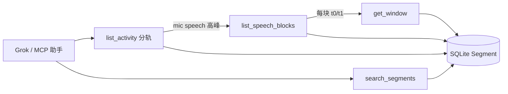

# ContextDay — Agent IO 优化 Spec（Post-MVP）

| 字段 | 值 |
|------|-----|
| 产品名 | ContextDay |
| Spec 文件 | `docs/02_spec.md` |
| Spec 版本 | **v0.1.0** |
| 状态 | **optimization_track** — 相对 MVP（`docs/01_spec.md` v0.3.7）的 Agent IO 表面增强；**不**替代 01 的 Phase 0–4 验收 |
| 创建时间 | 2026-10-29 20:40 Asia/Shanghai |
| 最后更新 | 2026-10-29 20:40 Asia/Shanghai |
| 目标平台 | macOS（与 01 相同） |
| 主工程路径（Mac） | `/Users/ruska/projects/ContextDay` |
| 云端工作区 | `/workspace`（经 GitHub 同步） |
| GitHub | 私有仓 https://github.com/jqlong17/ContextDay |
| MVP SSOT | [`docs/01_spec.md`](01_spec.md)（航运 / 商店 / Segment schema 权威） |
| 本文件职责 | Post-MVP **Agent IO 助手友好度**：分轨活动密度、ISO-8601 派生字段、轻量会议块元数据、统一错误与分页上限 |

> **关系**：`01` = 已定稿 MVP（采集 / 门控 / ASR / 浮控 / §2.9 首波工具）。`02` = 在 **不破坏 SQLite `Segment` schema** 的前提下，优化助手 IO（DTO / 工具语义 / 文档）。实现以本文件为合同；冲突时 **数据层与产品边界听 01**，Agent IO 表面听 02。

---

## 1. 项目背景（相对 01 的缺口）

### 1.1 要解决什么问题

MVP Agent IO（01 §2.9）已能供 Grok / MCP 拉转写，但仍有助手侧摩擦：

1. **`list_activity` 只有小时合计**（`track: null`），看不出麦轨 vs 系统轨活动密度，难判断「这小时是在开会还是在放歌」。
2. **时间只有 epoch ms**：助手每次手工用 `tz_at_capture` 换算墙钟，易错、占 token。
3. **长会议**只能 `get_window` 硬拉最多 500 段；没有「按静默间隙切成块」的元数据，又**禁止**本机 `summarize_window` LLM 摘要。
4. **错误 JSON / 分页上限**分散：HTTP 404/500 与工具错误字段不一致；硬上限（50 / 500）只活在源码常量里。

### 1.2 产品边界（本 Spec）

| 做（02） | 不做 |
|----------|------|
| DTO 增补派生 ISO-8601（权威仍为 `t0_ms`/`t1_ms`） | 改 SQLite `Segment` 表结构 / 用 ISO 作主键时间 |
| `list_activity` 分轨桶 + 可选合计 | 跨轨 mute 或改变门控语义 |
| 新工具 `list_speech_blocks`：gap 连续 speech 块**元数据** | `summarize_window` / 本机 LLM 摘要正文 |
| 统一错误 JSON；文档化 page / limit / hard cap | 导出音频字节（`export_audio` 仍 unavailable） |
| 更新 `agent-io-samples.md` / fixtures / XCTest | 改浮控 / 采集 / ASR / 商店叙事（仍属 01） |

### 1.3 与 01 的交叉引用

| 主题 | 权威 |
|------|------|
| 产品命名、浮控、留音、隐私、商店 | 01 |
| `Segment` SQLite 字段列表 | 01 §3.3（**本 Spec 禁止破改**） |
| MVP 首波四工具 + 技能 + `self_check` 存在性 | 01 §2.9 |
| 四工具的**优化语义**、新工具、错误/分页 | **本文件 §2** |
| 样例 JSON | `docs/agent-io-samples.md`（随 02 更新） |

### 1.4 设计原则

- **Additive over breaking**：优先加字段 / 加工具；`list_activity` 分轨为语义增强（桶从「仅合计」变为「分轨 + 可选合计」），须在样例与测试中明示。
- **权威时间仍是 UTC epoch ms**；ISO 为派生、可空策略明确。
- **无发明摘要**：块工具只返回边界与计数 / id 列表，正文仍由助手 `get_window` / `search_segments` 自取。
- **沙盒不变**：仅 `127.0.0.1`；Segment 只读。

---

## 2. 产品设计 — Agent IO 优化合同

### 2.1 目标体验（助手侧）

1. 问「今天下午哪段在认真说话」→ `list_activity` 看 **mic** 桶 `speech_count` 高峰，再 `list_speech_blocks` 取块边界，再 `get_window` 拉文本。
2. 纪要技能直接读 `t0_iso` / `t1_iso`，少做时区算术。
3. 任何失败看到同一形状的 `{error, message, …}`，HTTP 状态码可预期。
4. 长窗知道 500 硬顶：先切块再按块取，而不是 silently 截断却无指引。

### 2.2 非目标（明确）

- 不做本机会议摘要模型 / `summarize_window`。
- 不把 ISO 字符串写入 SQLite。
- 不引入 Day/Session 表（01 §3.3.5 仍成立；块为查询派生）。
- 不改剪贴板短索引产品路径（01 §2.8）；全文仍仅设置内查看。

### 2.3 承载与源码

| 路径 | 职责（02） |
|------|------------|
| `Features/AgentIO/AgentSegmentDTO.swift` | Segment / activity / speech-block DTO；ISO 派生 |
| `Features/AgentIO/AgentIOService.swift` | `list_activity` 分轨；`list_speech_blocks`；limit 常量公开 |
| `Features/AgentIO/AgentIOProtocol.swift` | 分发新工具；常量列表 |
| `Features/AgentIO/AgentIOError.swift` | 统一 `payload` |
| `Features/AgentIO/AgentIOHTTPServer.swift` | 404/4xx/5xx/501 同形 |
| `Features/AgentIO/AgentIOMCPStdio.swift` | `tools/list` 挂新工具 |
| `docs/agent-io-samples.md` | 请求/响应样例 |
| `docs/fixtures/agent-io/` | 离线 JSON 形状 |
| `Tests/AgentIO*.swift` | 合同测试 |

### 2.4 Segment DTO（优化后）

对外 JSON **snake_case**。SQLite 行不变；下列 **派生字段仅 DTO**：

| 字段 | 类型 | 权威? | 说明 |
|------|------|-------|------|
| `segment_id` | string (UUID 小写) | 是（来自 id） | |
| `t0_ms` / `t1_ms` | int64 | **是** | UTC epoch ms；查询/排序/窗相交仍只用它们 |
| `t0_iso` / `t1_iso` | string | 否（派生） | ISO-8601 **带偏移**（优先 `tz_at_capture`；缺省用设备当前时区）。例：`2024-10-29T08:02:00.000+08:00` |
| `track` | `"mic"` \| `"system"` | 是 | |
| `gate_label` | `"speech"` \| `"music"` \| `"other"` \| null | 是 | |
| `text` | string \| null | 是 | 可被 `max_chars` 截断 |
| `tz_at_capture` | string \| null | 是 | IANA；驱动 ISO 偏移 |
| `audio_path` | string \| null | 是 | 相对记录根 |

**ISO 规则**：

1. 格式：`yyyy-MM-dd'T'HH:mm:ss.SSSXXXXX`（毫秒 + 数字偏移，如 `+08:00` / `Z`）。
2. 时区：`TimeZone(identifier: tz_at_capture)`；identifier 无效或空 → `TimeZone.current`。
3. 不得用「无偏移的 naive 本地字符串」冒充 ISO。
4. 编码进 JSON 时与其它字段一样走 `sortedKeys`。

#### 2.4.1 请求/响应示例（单段）

```json
{
  "audio_path": null,
  "gate_label": "speech",
  "segment_id": "11111111-2222-3333-4444-555555555555",
    "t0_iso": "2024-10-29T08:02:00.000+08:00",
    "t0_ms": 1730160120000,
    "t1_iso": "2024-10-29T08:02:08.000+08:00",
    "t1_ms": 1730160128000,
  "text": "决议：周五前完成上线检查清单。",
  "track": "mic",
  "tz_at_capture": "Asia/Shanghai"
}
```

### 2.5 工具合同 — 既有工具增强

下列工具 **名称与 MVP 参数保持兼容**；仅增强返回或文档化上限。

#### 2.5.1 `search_segments`

| 项 | 值 |
|----|-----|
| 参数 | `t0_ms?`, `t1_ms?`, `query?`, `track?`, `page?`, `max_chars?` |
| `page` | 从 **0** 起；`offset = page * page_size` |
| `page_size` | **50**（固定；无客户端改 size） |
| 硬顶 | 单页最多 50；多页翻完即可；实现不另加全局 500 截断于本工具 |
| 返回 | `[AgentSegmentDTO]`（含 `t0_iso`/`t1_iso`）；无命中 `[]` |
| 窗语义 | 与 `[t0_ms,t1_ms]` **闭区间交集**（同 01） |

#### 2.5.2 `get_recent`

| 项 | 值 |
|----|-----|
| 参数 | `hours?` **或** `limit?`, `track?` |
| 缺省 | 都缺 → `hours=24` |
| `limit` 硬顶 | **500**（`min(500, max(1, limit))`） |
| 排序 | 最新在前 |
| 返回 | `[AgentSegmentDTO]` + ISO 字段 |

#### 2.5.3 `get_window`

| 项 | 值 |
|----|-----|
| 参数 | `t0_ms`, `t1_ms`, `track?`（必填时间） |
| 窗语义 | 闭区间交集 |
| 硬顶 | **500** 段；超出则返回前 500（按 store 查询序，通常 `t0_ms` 升序）并在响应**旁路**说明见下 |
| 长会议指引 | 优先 `list_speech_blocks` 得块 → 对每块再 `get_window(block.t0_ms, block.t1_ms)`；**不要**一次拉数小时全窗再期望本机摘要 |

**硬顶透明（小而优雅）**：当命中行数被硬顶截断时，成功 JSON **仍为数组**（保持 LLM 易解析），但 HTTP/MCP 层不另包 envelope。助手应：若 `length == 500`，假定可能截断，改用 `list_speech_blocks` 或缩小窗。本 Spec **不**强制 `truncated` 字段（避免破坏「根为数组」约定）；文档 + 技能模版写明该启发式。

`t1_ms < t0_ms` → `invalid_argument`。

#### 2.5.4 `list_activity`（分轨密度）

| 项 | 值 |
|----|-----|
| 参数 | `t0_ms?`, `t1_ms?`, `include_total?`（bool，默认 **true**） |
| 缺省窗 | `t1=now`，`t0=t1-24h` |
| 桶宽 | 本地/UTC 对齐的 **1 小时**（`floor(t0_ms / 3_600_000) * 3_600_000`，与 MVP 实现一致：按 UTC 小时边界；展示用 ISO 转本地） |
| 扫描硬顶 | 参与分桶的段最多 **500**（同 `get_window`）；超窗请缩小范围 |

**返回行** `AgentActivityBucketDTO`：

| 字段 | 类型 | 说明 |
|------|------|------|
| `bucket_start_ms` / `bucket_end_ms` | int64 | 权威 |
| `bucket_start_iso` / `bucket_end_iso` | string | 派生；时区：桶内首段的 `tz_at_capture`，否则设备当前 |
| `track` | `"mic"` \| `"system"` \| `null` | **分轨行**为 mic/system；`null` 仅当 `include_total=true` 的合计行 |
| `segment_count` | int | 该桶该轨段数 |
| `speech_count` | int | `gate_label == speech` 的段数（密度信号） |
| `music_count` | int | `gate_label == music` |
| `other_count` | int | 其余（含 null gate） |

**生成规则**：

1. 对每个有数据的 `(hour_bucket, track∈{mic,system})` 发一行（`segment_count > 0`）。
2. 若 `include_total == true`（默认），对同一 `hour_bucket` 再发一行 `track: null`，计数为两轨合计。
3. 排序：`bucket_start_ms` 升序；同桶内顺序 `mic` → `system` → `null`(total)。
4. 空窗 → `[]`。

**响应示例**：

```json
[
  {
    "bucket_end_iso": "2024-10-29T09:00:00.000+08:00",
    "bucket_end_ms": 1730163600000,
    "bucket_start_iso": "2024-10-29T08:00:00.000+08:00",
    "bucket_start_ms": 1730160000000,
    "music_count": 0,
    "other_count": 0,
    "segment_count": 5,
    "speech_count": 5,
    "track": "mic"
  },
  {
    "bucket_end_iso": "2024-10-29T09:00:00.000+08:00",
    "bucket_end_ms": 1730163600000,
    "bucket_start_iso": "2024-10-29T08:00:00.000+08:00",
    "bucket_start_ms": 1730160000000,
    "music_count": 1,
    "other_count": 0,
    "segment_count": 1,
    "speech_count": 0,
    "track": "system"
  },
  {
    "bucket_end_iso": "2024-10-29T09:00:00.000+08:00",
    "bucket_end_ms": 1730163600000,
    "bucket_start_iso": "2024-10-29T08:00:00.000+08:00",
    "bucket_start_ms": 1730160000000,
    "music_count": 1,
    "other_count": 0,
    "segment_count": 6,
    "speech_count": 5,
    "track": null
  }
]
```

### 2.6 新工具 — `list_speech_blocks`

> **不是** `summarize_window`。只返回连续 speech 的时间块元数据，便于长会议分页拉取。

| 项 | 值 |
|----|-----|
| 参数 | `t0_ms?`, `t1_ms?`, `track?`（默认 **mic** — 纪要主路径）, `gap_ms?`（默认 **120000** = 2 分钟）, `gate?`（默认 `"speech"`；仅 `"speech"` 首版） |
| 缺省窗 | 同 `list_activity`：最近 24h |
| 算法 | 取窗内指定轨且 `gate_label == speech` 的段，按 `t0_ms` 升序；若 `next.t0_ms - prev.t1_ms ≤ gap_ms` 则并入同一 block；否则新开 block |
| 扫描硬顶 | 输入段 **500**；块数量 ≤ 输入段数 |
| 返回 | `[AgentSpeechBlockDTO]`；无 speech → `[]` |

**`AgentSpeechBlockDTO`**：

| 字段 | 类型 | 说明 |
|------|------|------|
| `track` | string | |
| `t0_ms` / `t1_ms` | int64 | 块覆盖（min t0 / max t1） |
| `t0_iso` / `t1_iso` | string | 派生 |
| `segment_count` | int | |
| `speech_chars` | int | 块内 `text` 字符数之和（null text 计 0） |
| `segment_ids` | [string] | 有序 UUID 小写 |
| `gap_ms_used` | int | 本次合并使用的 gap |
| `tz_at_capture` | string \| null | 块内首段时区 |

**推荐助手模式（长会议）**：

```text
1. list_activity → 找 mic speech_count 高峰小时
2. list_speech_blocks(t0,t1, track=mic, gap_ms=120000)
3. 对每个 block: get_window(block.t0_ms, block.t1_ms, track=mic)
4. 按技能模版写纪要（上层 LLM）
5. 永不调用 summarize_window
```

**请求示例**：

```http
POST /v1/tools/list_speech_blocks
Content-Type: application/json

{"t0_ms":1730160000000,"t1_ms":1730160300000,"track":"mic","gap_ms":120000}
```

**响应示例**：

```json
[
  {
    "gap_ms_used": 120000,
    "segment_count": 5,
    "segment_ids": [
      "aaaaaaaa-bbbb-cccc-dddd-000000000001",
      "aaaaaaaa-bbbb-cccc-dddd-000000000002"
    ],
    "speech_chars": 86,
    "t0_iso": "2024-10-29T08:00:00.000+08:00",
    "t0_ms": 1730160000000,
    "t1_iso": "2024-10-29T08:04:08.000+08:00",
    "t1_ms": 1730160248000,
    "track": "mic",
    "tz_at_capture": "Asia/Shanghai"
  }
]
```

### 2.7 非本波（仍 unavailable）

| 工具 | 状态 |
|------|------|
| `summarize_window` | **unavailable** — 留给上层；02 **不**复活 |
| `export_audio` | **unavailable** |

### 2.8 统一错误 JSON（§2.9 对齐名：本 Spec §2.8）

所有 Agent IO HTTP 错误体与 `AgentIOError.payload`（经 MCP `isError` 文本）使用同一形状：

```json
{
  "error": "<code>",
  "message": "<human-readable>",
  "tool": "<name>"
}
```

| 字段 | 必填 | 说明 |
|------|------|------|
| `error` | 是 | 稳定机器码 |
| `message` | 是 | 可读说明 |
| `tool` | 条件 | `unavailable` / 与某工具强绑定时必填；参数错误时可省略或填工具名 |

**`error` 枚举**：

| code | HTTP | 何时 |
|------|------|------|
| `invalid_argument` | 400 | 缺参、`t1 < t0`、非法 name 等 |
| `not_found` | 404 | 技能文件不存在；未知 HTTP 路径 |
| `unavailable` | 501 | 非本波工具 / 未知工具名 |
| `internal` | 500 | 未预期异常 |

**禁止**：仅把 `error` 设为自由文本 localizedDescription；禁止 404 用 `app` 替代 `message`。

**示例 — unavailable**：

```json
{
  "error": "unavailable",
  "message": "not in first wave; leave summarization to the upstream assistant",
  "tool": "summarize_window"
}
```

**示例 — invalid_argument**：

```json
{
  "error": "invalid_argument",
  "message": "get_window requires t0_ms and t1_ms"
}
```

**示例 — HTTP 404**：

```json
{
  "error": "not_found",
  "message": "no such route"
}
```

### 2.9 分页与硬上限一览（助手必读）

| 工具 | 分页 | 页大小 / limit | 硬顶 | 截断行为 |
|------|------|---------------|------|----------|
| `search_segments` | `page`（0-based） | 50 / 页 | — | 翻页；末页可短 |
| `get_recent` | `limit` | 调用方 | **500** | clamp 到 500 |
| `get_window` | 无 | — | **500** | 返回最多 500；若恰好 500 → 可能截断，应改用块工具 |
| `list_activity` | 无 | — | 扫描 **500** 段再分桶 | 缩小时间窗 |
| `list_speech_blocks` | 无 | — | 扫描 **500** 段 | 缩小窗或增大 `gap_ms` 减块数 |
| 技能 / `self_check` | — | — | — | 不适用 |

实现须把 `pageSize` / `hardLimit` 集中为 `AgentIOService` 常量（或 `enum AgentIOLimits`），避免魔法数漂移。

### 2.10 技能工具与诊断

01 已定稿的 `list_agent_skills` / `get_agent_skill` / `update_agent_skill` / `reset_agent_skill` / `get_clipboard_prompt` / `self_check` **语义不变**。错误码纳入 §2.8。MCP `tools/list` 须包含 `list_speech_blocks`。

### 2.11 与剪贴板 / 完整提示词

短索引（01 §2.8.1）可在「建议做法」中**可选**提及 `list_speech_blocks`（非破坏）。完整提示词正文（01 §2.8.2）工具列表增补一行 `list_speech_blocks` — 属文案同步，不改「短索引不入全文」政策。

---

## 3. 技术架构（相对 01 的增量）

### 3.1 模块影响面

```text
Features/AgentIO/          # 主改动
  AgentSegmentDTO.swift    # + ISO; + speech counts; + AgentSpeechBlockDTO
  AgentIOService.swift     # list_activity rewrite; listSpeechBlocks; Limits
  AgentIOProtocol.swift    # dispatch list_speech_blocks
  AgentIOError.swift       # payload 统一
  AgentIOHTTPServer.swift  # 404/500 同形
  AgentIOMCPStdio.swift    # descriptor
Features/Store/            # 不改 Segment schema；复用 querySegments
docs/01_spec.md            # 仅交叉链接 + 小版本备忘（不搬合同）
docs/02_spec.md            # 本文件
docs/agent-io-samples.md   # 样例同步
docs/fixtures/agent-io/    # JSON fixtures
Tests/                     # AgentIOServiceTests + MeetingFixture
```

### 3.2 ISO 派生实现要点

- 纯函数：`AgentIOTime.iso8601(epochMs:timeZoneIdentifier:)`。
- 使用 `ISO8601DateFormatter` 或 `DateFormatter` 固定 locale `en_US_POSIX`；须含小数秒与偏移。
- 单元测试：固定 `t0_ms` + `Asia/Shanghai` → 稳定字符串（注意夏令时：上海无 DST）。

### 3.3 `list_speech_blocks` 伪代码

```text
rows = query(t0,t1,track).filter(gate==speech).sorted(by: t0)
blocks = []
for seg in rows:
  if blocks.last exists AND seg.t0 - blocks.last.t1 <= gap:
    extend last
  else:
    append new block from seg
return blocks as DTOs
```

### 3.4 数据模型

- **SQLite `Segment`：不变**（01 §3.3）。
- 新类型仅内存 DTO；无新表。

### 3.5 失败与降级

| 故障 | 行为 |
|------|------|
| 非法 `gap_ms`（≤0） | `invalid_argument` |
| 未知 `track` 字符串 | 视作未过滤或 `invalid_argument`（实现选一并测；推荐 **invalid_argument**） |
| ISO 时区 id 无效 | 静默回退 `TimeZone.current`，不报错 |
| 硬顶截断 | 见 §2.9；不抛错 |

---

## 4. 架构关系图（助手拉取）



---

## 5. 开发任务执行计划（02）

### Phase A — Spec 与交叉链接

- [x] 新建 `docs/02_spec.md` v0.1.0（本文件）
- [x] `docs/01_spec.md` 增加指向 02 的简短交叉链接（不迁就合同；01 → v0.3.8）
- [x] `README.md` 提及 02 为 Agent IO 优化轨

### Phase B — DTO / 时间 / 错误

- [x] `t0_iso` / `t1_iso` 及 activity / block ISO 字段
- [x] `AgentIOError` + HTTP 404/500 统一 payload
- [x] `AgentIOLimits`（pageSize=50, hardLimit=500）

### Phase C — 工具语义

- [x] `list_activity` 分轨 + `speech_count`/`music_count`/`other_count` + `include_total`
- [x] `list_speech_blocks` + Protocol/MCP/HTTP 挂载
- [x] `get_window` / 文档长会议指引

### Phase D — 样例 / fixtures / 测试

- [x] 更新 `docs/agent-io-samples.md`
- [x] fixtures + `Scripts/validate-agent-io-samples.py`
- [x] XCTest：分轨、ISO、speech blocks、错误形
- [x] 完整提示词工具列表补 `list_speech_blocks`（`AgentPromptTemplate`）

### Phase E — PR

- [ ] 提交分支 `cursor/agent-io-opt-spec-02-6206`；开 PR；父机 squash-merge

---

## 6. 测试用例（02）

| ID | 场景 | 步骤要点 | 期望 |
|----|------|----------|------|
| T01 | Segment ISO | 固定 ms + `Asia/Shanghai` 编码 DTO | 含 `t0_iso`/`t1_iso`；偏移 `+08:00`；权威 ms 不变 |
| T02 | ISO 缺 tz | `tz_at_capture=null` | ISO 仍产出（设备 tz）；不崩溃 |
| T03 | activity 分轨 | fixture 同时有 mic+system | 同小时出现 `track=mic` 与 `track=system` 行；`speech_count` 合理 |
| T04 | activity total | 默认 `include_total` | 另有 `track=null` 行；`segment_count` = 分轨之和 |
| T05 | activity no total | `include_total=false` | 无 `track=null` 行 |
| T06 | speech blocks merge | 同轨 speech 间隙 ≤ gap | 并成一块；`segment_ids` 有序 |
| T07 | speech blocks split | 间隙 > gap | 两块 |
| T08 | blocks 跳过 music | system music + mic speech | 默认 track=mic 块不含 music |
| T09 | gap_ms 非法 | `gap_ms=0` | `invalid_argument` |
| T10 | 错误形 unavailable | `summarize_window` | payload 含 `error`/`message`/`tool`；HTTP 501 |
| T11 | 错误形 404 | 未知路径 | `error=not_found` + `message` |
| T12 | search page | page=0 size 行为 | ≤50；snake_case + ISO |
| T13 | get_window 硬顶文档 | 文档/样例写明 500 启发式 | 与实现常量一致 |
| T14 | MCP list | `tools/list` | 含 `list_speech_blocks` |
| T15 | fixtures validate | `python3 Scripts/validate-agent-io-samples.py` | OK |
| T16 | schema 未破 | 打开 DB | Segment 表列与 01 §3.3 一致 |

---

## 7. 验收标准（02）

1. `docs/02_spec.md` 与实现一致；`01` 仍为 MVP SSOT 且 Segment schema 未破改。
2. 所有返回 Segment 的工具带 `t0_iso`/`t1_iso`；activity/blocks 带对应 ISO。
3. `list_activity` 默认可见 mic/system 分轨密度 + total；可关 total。
4. `list_speech_blocks` 可用；`summarize_window` 仍 501 unavailable。
5. 错误 JSON 三字段约定在 HTTP/MCP/单元测试中成立。
6. §2.9 表中的 50/500 上限与源码常量一致；样例文档已写长会议模式。
7. `validate-agent-io-samples.py` 与相关 XCTest 通过（Mac 上 XCTest；Linux 至少 fixtures 脚本）。

---

## 8. 备忘录

- 分轨 activity **不是**跨轨 mute；system music 行与 mic speech 行并存是正确的。
- `gap_ms` 默认 2 分钟 deliberately **大于**落库 merge gap（2s）：块 ≈「话题/发言轮次」，不是 VAD 句。
- ISO 派生失败回退不得抛到助手；ms 永远可作权威。
- 若未来要 envelope（`{items, truncated}`），需升 02 次版本并提供兼容窗；本 v0.1.0 保持根数组。
- 父机 squash-merge 后，视需要把 01 §10「执行状态」Agent IO 行改为「MVP + 02 优化已合入」。

---

## 9. Spec 版本信息与时间点

| 版本 | 时间（Asia/Shanghai） | 说明 |
|------|----------------------|------|
| v0.1.0 | 2026-10-29 20:40 | 初稿：分轨 `list_activity`、ISO 派生、`list_speech_blocks`、统一错误、分页上限；与 01 v0.3.7 交叉链接 |

变更规则：仅影响 Agent IO 表面时升 02 的 v0.x；若被迫改 SQLite schema，必须同步 01 破坏性流程并在两份 Spec 备忘标明。

---

## 10. 执行状态

| 项 | 状态 | 备注 |
|----|------|------|
| Spec v0.1.0 正文 | **已完成** | 详细合同 |
| 01 交叉链接 | **已完成** | 01 v0.3.8；不替换 01 |
| ISO DTO | **已完成** | `AgentIOTime` + DTO 字段 |
| list_activity 分轨 | **已完成** | mic/system + optional total |
| list_speech_blocks | **已完成** | gap 元数据；非摘要 |
| 统一错误 + 分页文档 | **已完成** | `AgentIOError` / Limits / samples |
| samples / fixtures / tests | **已完成** | validate 脚本可 Linux 跑 |
| PR 合入 | 待审 | 父机 squash-merge |

**当前总状态：02 Spec v0.1.0 + 同 PR 实现已就绪；01 保持 MVP SSOT；待 squash-merge。**

---

## 11. 参考

- MVP Spec：[`docs/01_spec.md`](01_spec.md)
- 样例：[`docs/agent-io-samples.md`](agent-io-samples.md)
- HTTP/MCP 操作说明：[`docs/agent-io-mcp.md`](agent-io-mcp.md)
